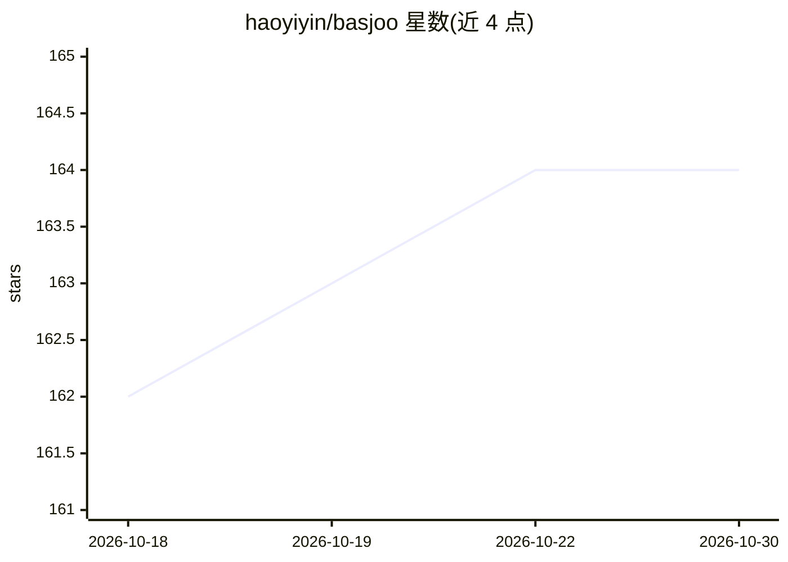

# haoyiyin/basjoo

⭐ 164 · Python · MIT · 推送 2026-10-29 · [GitHub](https://github.com/haoyiyin/basjoo) · [官网](https://basjoo.de) · 个人维护 · 中文 README

**面向客服场景的开源 AI 客服平台：RAG 知识库+多供应商 LLM+可嵌入聊天挂件**

三部分组成：FastAPI 后端（agent 配置、聊天、索引、认证、调度）、Next.js 管理面板、可嵌入网站的聊天挂件（HTTP+SSE 流式）。通过 URL 抓取与文件上传构建知识库，经 Qdrant 向量检索与 Jina/SiliconFlow 嵌入生成带来源引用的回答。LLM 调用全部走外部 API（OpenAI/DeepSeek/Anthropic/Gemini 等），无需 GPU。以 Docker Compose 一键部署为主，也提供脚本安装与本地源码运行；支持多 agent 隔离、人工接管、会话配额与限流。

## 筛选速览

| 维度 | 判定 | 备注 |
|---|---|---|
| AI 角色 | `ai-native` | 本体是模型或模型工具 |
| 许可风险 | `permissive` | MIT |
| 部署形态 | `self-host` | docker 或自建部署 |
| 模型依赖 | locked-api |  |
| 硬件要求 | — | 无带数字的原话,不猜 |
| 安装摩擦 | `low` | 无编译、无系统依赖或容器化 |
| 成熟度 | — | 结构信号不足 |

## 能力要点

- URL 抓取与多格式文件（PDF/DOCX/CSV 等）作为 RAG 知识源
- 可嵌入网站挂件，SSE 流式回答与会话持久化
- 多 LLM 供应商配置，嵌入服务可独立选择 Jina 或 SiliconFlow
- Docker Compose 开发/生产双 profile 与一键部署脚本

## 适用场景

- 在网站上嵌入 AI 客服挂件，基于自有知识库回答访客问题
- 客服团队监控实时会话并人工接管对话
- 为多个产品/租户配置相互隔离的 AI agent

## 场景标签

`聊天机器人` `RAG` · 领域:对话与助手

## 证据(README 行号)

> L15: Basjoo is an AI customer-support platform with three main parts:
> L25: Basjoo runs as a set of Docker containers. All LLM inference and embedding calls are made to external APIs (OpenAI,
> L65: - Configurable AI agents with multiple provider settings

## 星数曲线

2026-10-18 162 → 2026-10-30 164（+2）

---
*卡片 v1 · prompt 1.4 · 生成 2026-10-22 · 置信度 mid · 依据 README sha `c9efe3fdb8cc` · [字段定义](../../DATASET.md)*
