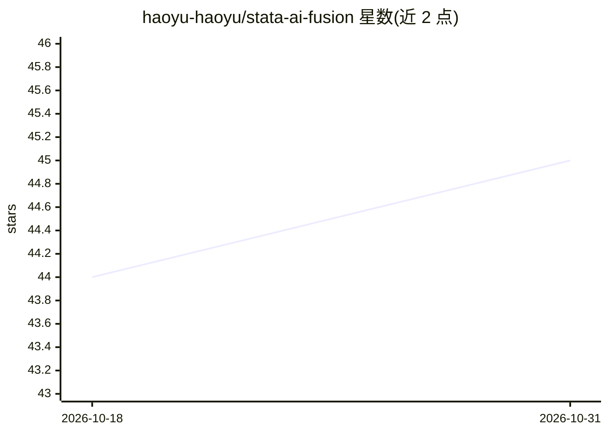

# haoyu-haoyu/stata-ai-fusion

⭐ 45 · Python · MIT · 推送 2026-06-22 · [GitHub](https://github.com/haoyu-haoyu/stata-ai-fusion) · 个人维护 · 中文 README

**让 AI 助手直接执行 Stata 的 MCP Server + 技能库 + VS Code 扩展**

面向 Stata 用户的 AI 集成套件，含三个组件：MCP Server 提供 11 个工具，使 Claude、Cursor 等 MCP 兼容助手能启动持久 Stata 会话、执行命令、检查数据、提取结果与导出图形，支持多会话数据隔离与 Stata 自动发现（MP/SE/IC/BE）；5,653 行技能知识库采用渐进式披露架构，按需加载 14 个领域参考文件（计量经济学、因果推断、生存分析等）；另有提供语法高亮、代码片段与运行功能的 VS Code 扩展。需本地安装 Stata，通过 uvx/pip 安装，Windows 下 pexpect 支持有限。

## 筛选速览

| 维度 | 判定 | 备注 |
|---|---|---|
| AI 角色 | `ai-ecosystem` | LLM/agent 周边工具 |
| 许可风险 | `permissive` | MIT |
| 部署形态 | `desktop` | 安装包/桌面程序 |
| 模型依赖 | locked-api |  |
| 硬件要求 | — | 无带数字的原话,不猜 |
| 安装摩擦 | `low` | 无编译、无系统依赖或容器化 |
| 成熟度 | — | 结构信号不足 |

## 能力要点

- 11 个 MCP 工具：执行命令、跑 do 文件、提取结果、导出图形、多会话管理
- 5,653 行 Stata 技能知识库，渐进式披露按需加载 14 个参考文件
- Stata 安装三级自动发现，支持 MP/SE/IC/BE 版本
- VS Code 扩展提供 25 个语法作用域、30 个代码片段与选区运行

## 适用场景

- 在 Claude Code 或 Cursor 中用自然语言驱动 Stata 完成回归与数据分析
- 将 Stata 专业知识库上传 Claude.ai 项目获取代码生成指导
- 在 VS Code 中编写与运行 .do 文件并获得语法支持

## 场景标签

`数据分析` `代码生成` · 领域:效率与自动化

## 证据(README 行号)

> L22: **stata-ai-fusion** bridges that gap. It gives AI assistants (Claude, Cursor, GitHub Copilot, and others) the abili
> L28: |**MCP Server**|11 tools that let any MCP-compatible AI execute Stata|Claude Desktop, Claude Code, Cursor users|
> L38: 1. **AI Assistant** sends a tool call (e.g. `stata_run_command`) via MCP.

## 星数曲线

2026-10-18 44 → 2026-10-31 45（+1）

---
*卡片 v1 · prompt 1.4 · 生成 2026-10-25 · 置信度 high · 依据 README sha `a0446fde4a63` · [字段定义](../../DATASET.md)*
