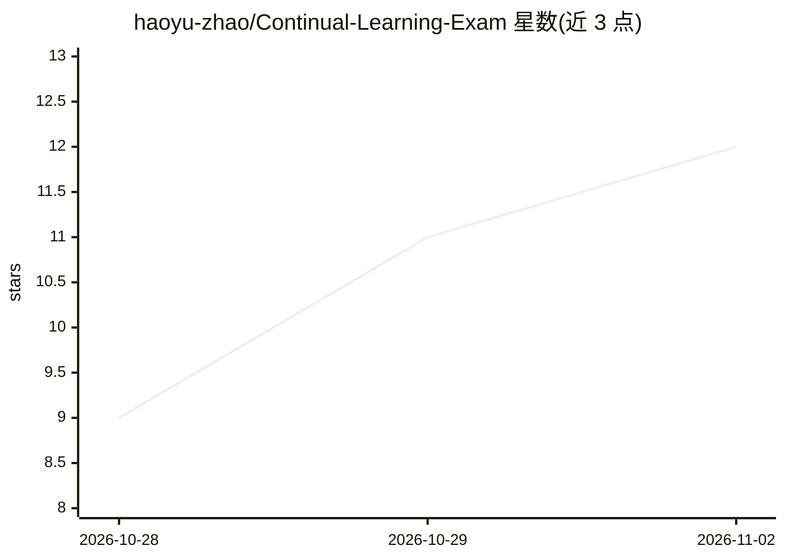

# haoyu-zhao/Continual-Learning-Exam

⭐ 12 · TeX · 推送 2026-10-27 · [GitHub](https://github.com/haoyu-zhao/Continual-Learning-Exam) · [官网](https://haoyu-zhao.github.io/CLE/) · 组织维护

**评测 AI agent 持续学习能力的基准：120 任务·600 关卡**

Continual Learning Exam（CLE）是评测 agent 能否习得、保留并复用经验的基准：120 个人类撰写的专业任务，每任务 5 个递进关卡共 600 项，环境状态与经验跨关卡延续，由人工评分标准判定通过。由 50+ 领域专家构建，覆盖 89 个职业角色、12 个领域。提供 CLE Lite（20 任务/100 关卡）公开数据集与运行时，支持 Direct 与 CLE 两种评测模式及 Trial 1/Trial 2 设定。完整任务包、容器环境与评分材料需申请批准访问；单示例任务需预留 30 GB 磁盘。

## 筛选速览

| 维度 | 判定 | 备注 |
|---|---|---|
| AI 角色 | `ai-ecosystem` | LLM/agent 周边工具 |
| 许可风险 | `none` | — |
| 部署形态 | `library` | 以包/库形式分发 |
| 模型依赖 | — | README 未给出锁定关系 |
| 硬件要求 | — | 无带数字的原话,不猜 |
| 安装摩擦 | `low` | 无编译、无系统依赖或容器化 |
| 成熟度 | — | 结构信号不足 |

## 能力要点

- 120 个人类撰写任务、600 关卡，关卡间文件与经验延续
- 两种评测模式（Direct/CLE）× Trial 1/Trial 2 提交设定
- CLE Lite 公开数据集含 100 任务卡与 3,309 条评分标准
- 在线排行榜覆盖 11 个模型变体、4 种 harness 的 17 组配置

## 适用场景

- 评测我所开发的 agent 在长程任务中的持续学习能力
- 对比不同模型与 harness 在经验积累下的表现增益
- 基于 CLE Lite 公开数据复现基准实验

## 场景标签

`模型评测` · 领域:评测与运维

## 证据(README 行号)

> L37: **Continual Learning Exam (CLE)** measures whether agents can learn from experience and use it in later work. Built
> L119: The main evaluation compares **17 configurations** spanning **11 model variants** and **4 harnesses**: Claude Code

## 星数曲线

2026-10-28 9 → 2026-11-02 12（+3）

---
*卡片 v1 · prompt 1.4 · 生成 2026-11-02 · 置信度 mid · 依据 README sha `e216ad45fe43` · [字段定义](../../DATASET.md)*
