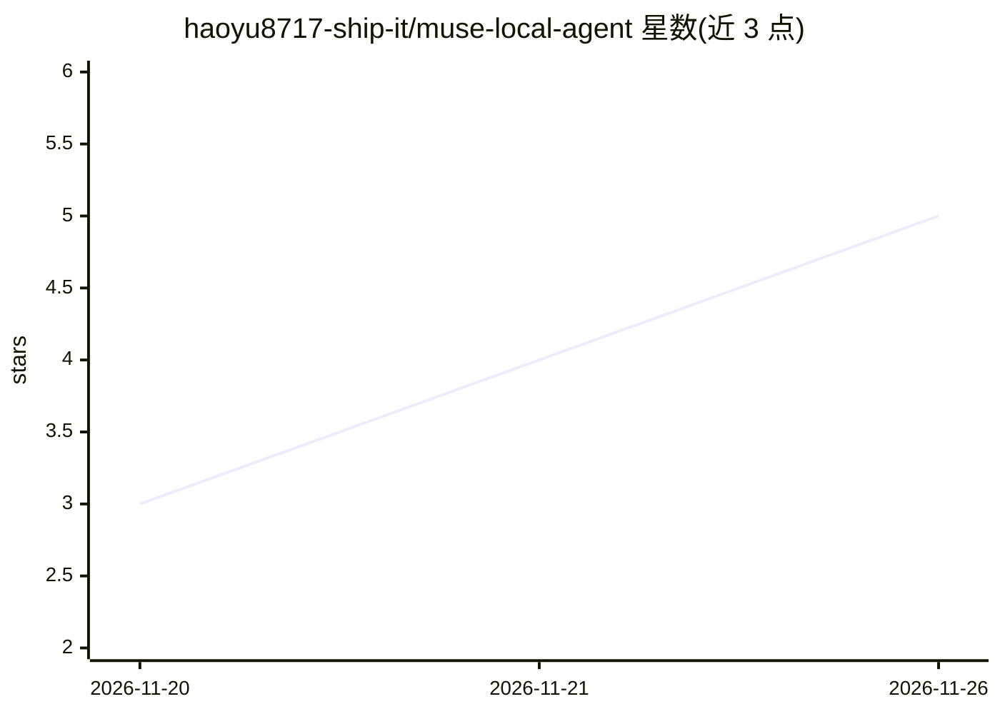

# haoyu8717-ship-it/muse-local-agent

⭐ 5 · Shell · MIT · 推送 2026-11-19 · [GitHub](https://github.com/haoyu8717-ship-it/muse-local-agent) · 个人维护

**让 Muse AI 代理把 Windows PC、Linux 云 VM 和 Android 手机当一套系统操作的技能配方**

面向 Muse（Meta 个人 AI 代理）的技能包：核心是 SKILL.md 中的端到端本地代理栈配方——云 VM 经 SSH/Tailscale 桥接到达登录会话内的 Windows-MCP 服务器，暴露 18 个工具（streamable-HTTP、Bearer 认证），Android 端经 Tasker/AutoX.js/Shizuku/scrcpy 自动化；附带自愈 SSH 隧道脚本、systemd 单元（已归档）与迭代日志机制（OPTIMIZATION_LOG.md）。安装方式为克隆仓库并将 SKILL.md/skill.yaml 复制到 Muse 自定义技能目录，或直接阅读配方章节。依赖 Muse 代理环境才能使用。

## 筛选速览

| 维度 | 判定 | 备注 |
|---|---|---|
| AI 角色 | `ai-knowledge` | 知识聚合/清单类 |
| 许可风险 | `permissive` | MIT |
| 部署形态 | `None` |  |
| 模型依赖 | — | README 未给出锁定关系 |
| 硬件要求 | — | 无带数字的原话,不猜 |
| 安装摩擦 | `low` | 无编译、无系统依赖或容器化 |
| 成熟度 | — | 结构信号不足 |

## 能力要点

- SKILL.md 内含 2026-11-17 构建并验证的端到端本地代理栈配方
- Windows-MCP 服务器暴露 18 个工具，走 SSH 隧道 + Bearer token 认证
- 自愈 SSH 隧道循环脚本，无需 systemd/cron
- OPTIMIZATION_LOG.md 迭代日志：按需触发、修因记录、带外验证

## 适用场景

- 让 Muse 代理统一操作我的 Windows PC、Linux 云 VM 和 Android 手机
- 参照配方在自己机器上搭建本地代理栈
- 用迭代日志机制持续排查并修复代理栈故障

## 场景标签

`GUI 自动化` · 领域:效率与自动化

## 证据(README 行号)

> L7: A skill for Muse (Meta's personal AI agent) that teaches it to operate your machines as one system:
> L13: The core is the **verified end-to-end local-agent stack recipe** (in `SKILL.md`): SSH bridge, Windows-MCP server, l
> L36: Clone this repo and copy `SKILL.md` and `skill.yaml` into your Muse custom skills directory (`~/workspace/custom-sk

## 星数曲线

2026-11-20 3 → 2026-11-26 5（+2）

---
*卡片 v1 · prompt 1.4 · 生成 2026-11-21 · 置信度 high · 依据 README sha `b8e0e541a064` · [字段定义](../../DATASET.md)*
