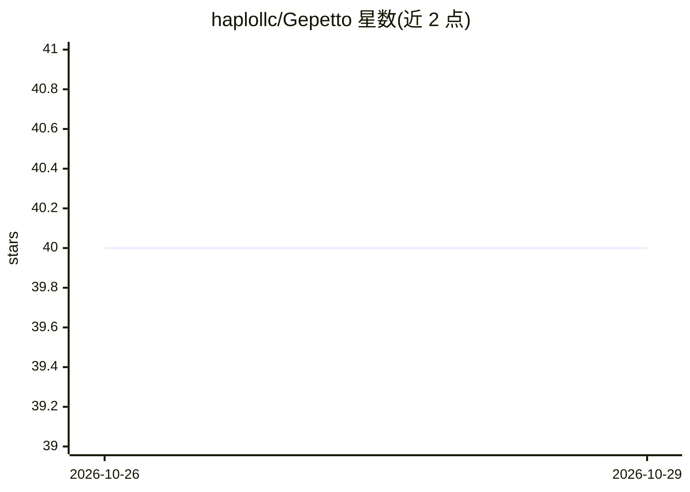

# haplollc/Gepetto

⭐ 40 · Swift · MIT · 推送 2026-10-26 · [GitHub](https://github.com/haplollc/Gepetto) · 组织维护

**SwiftUI 库：可人工接管的人机协作浏览器 Agent（iOS/macOS）**

面向开发者的 Swift 包：提供驱动真实 WKWebView 的浏览器 Agent，模型按步骤读取页面可交互元素列表、以 JSON 输出动作，代理执行并反馈变化。内置人工接管机制（暂停/接管/交还）、敏感操作审批（购买/发送/删除先询问）、隐私防护（密码与支付字段不进入模型）。模型侧通过 GepettoAIEngine 协议接入，支持 llama.cpp、MLX、Apple Foundation Models 或任意 HTTP API；小模型友好的单步压缩提示与宽容 JSON 解析。需 iOS 16+/macOS 13+、Swift 5.9。

## 筛选速览

| 维度 | 判定 | 备注 |
|---|---|---|
| AI 角色 | `ai-ecosystem` | LLM/agent 周边工具 |
| 许可风险 | `permissive` | MIT |
| 部署形态 | `None` |  |
| 模型依赖 | — | README 未给出锁定关系 |
| 硬件要求 | — | 无带数字的原话,不猜 |
| 安装摩擦 | `low` | 无编译、无系统依赖或容器化 |
| 成熟度 | — | 结构信号不足 |

## 能力要点

- 驱动真实 WKWebView，逐步读取页面并以 JSON 动作执行
- 人工随时接管/交还机制，验证码与支付表单自动交还给人
- 敏感操作（购买/发送/删除）默认先审批，账户变更默认阻止
- GepettoAIEngine 协议兼容 llama.cpp/MLX/Apple Foundation Models/HTTP API

## 适用场景

- 在 iOS/macOS 应用中嵌入可用自然语言驱动的浏览器自动化
- 需要人工介入登录、验证码、支付环节的代理任务
- 用 Apple 端侧模型做不出设备的本地浏览代理

## 场景标签

`浏览器自动化` · 领域:效率与自动化

## 证据(README 行号)

> L58: `model` is anything that conforms to `GepettoAIEngine`, one streaming function. It works with llama.cpp, MLX, Apple
> L54: let agent = BrowserAgent()
> L18: Gepetto drives a real `WKWebView` from one sentence. Each step the model reads the page as a short numbered list of

## 星数曲线

2026-10-26 40 → 2026-10-29 40（+0）

---
*卡片 v1 · prompt 1.4 · 生成 2026-10-25 · 置信度 high · 依据 README sha `f365b4734de7` · [字段定义](../../DATASET.md)*
