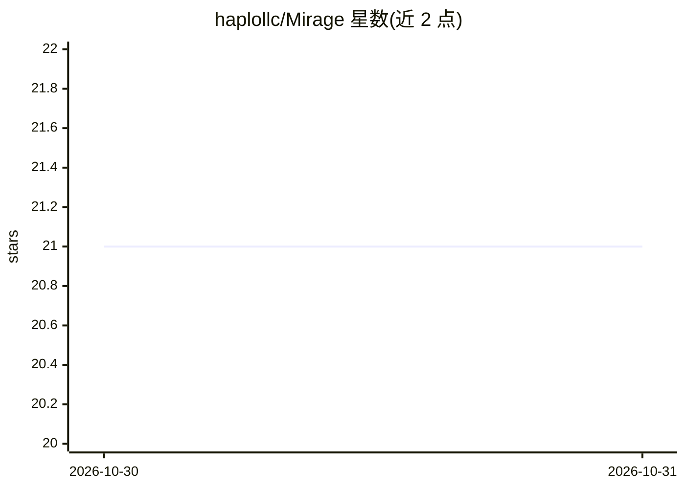

# haplollc/Mirage

⭐ 21 · Swift · NOASSERTION · 推送 2026-10-28 · [GitHub](https://github.com/haplollc/Mirage) · 组织维护

**iOS/macOS/visionOS 端侧文生图引擎 Swift 封装库**

面向 Apple 平台开发者的 Swift Package，将 stable-diffusion.cpp 与 ggml-metal 预编译为 XCFramework 嵌入，通过单 actor Engine API 加载 GGUF 格式扩散模型生成图像，无需 Core ML 转换。支持 SD/SDXL/SD3/Flux/Chroma/Qwen-Image/ERNIE-Image/Z-Image 等家族，附 iPhone 运行所需的 entitlements、内存门控、符号冲突规避与设备内存分档说明。模型权重经 Hugging Face 镜像仓库分发，开发者可按设备 RAM 限制筛选可加载模型。

## 筛选速览

| 维度 | 判定 | 备注 |
|---|---|---|
| AI 角色 | `ai-ecosystem` | LLM/agent 周边工具 |
| 许可风险 | `permissive` | NOASSERTION |
| 部署形态 | `None` |  |
| 模型依赖 | — | README 未给出锁定关系 |
| 硬件要求 | — | 无带数字的原话,不猜 |
| 安装摩擦 | `medium` | 含编译或系统依赖之一 |
| 成熟度 | — | 结构信号不足 |

## 能力要点

- 嵌入 stable-diffusion.cpp + ggml-metal，免 Core ML 转换运行 GGUF 扩散模型
- 单 actor Engine + generate API 返回 CGImage，SPM 二进制目标免 cmake/ninja
- iPhone 端 jetsam 规避：increased-memory-limit entitlements 与按可用内存门控加载
- 与 llama.cpp 共存时的符号隐藏方案（仅导出 12 个 mirage_* C 入口）

## 适用场景

- 在 iOS/macOS 应用内集成端侧文生图能力
- iPhone 上按设备内存档位加载 Z-Image-Turbo/ERNIE-Image-Turbo 等模型生成图片
- 为图像生成 UI 提供逐步进度回调与 ETA 计算

## 场景标签

`图像生成` `推理引擎` · 领域:内容生成

## 证据(README 行号)

> L2: A one-stop on-device diffusion image-generation engine for iOS, macOS and visionOS that runs anything stable-diffusi
> L43: Mirage takes a different approach: **embed `stable-diffusion.cpp` + `ggml-metal`** into a clean Swift package. Anyt
> L233: - **Public Swift API** is one `actor Engine` + `Engine.generate(_:)` returning `CGImage`. Actor isolation serializ

## 星数曲线

2026-10-30 21 → 2026-10-31 21（+0）

---
*卡片 v1 · prompt 1.4 · 生成 2026-10-30 · 置信度 high · 依据 README sha `db1c211aa6f8` · [字段定义](../../DATASET.md)*
