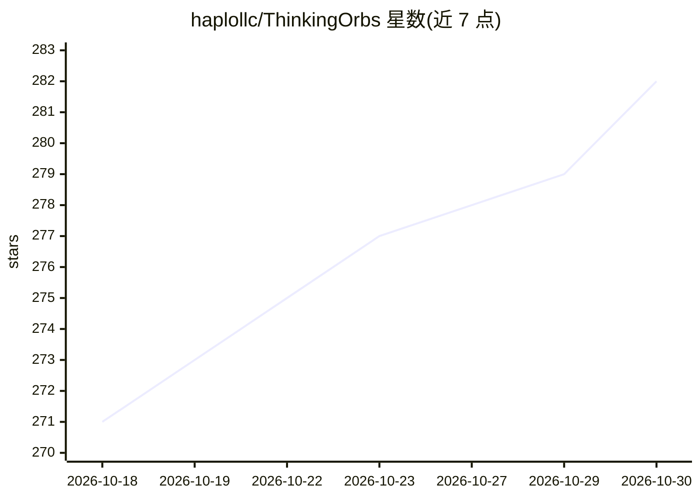

# haplollc/ThinkingOrbs

⭐ 282 · Swift · MIT · 推送 2026-10-28 · [GitHub](https://github.com/haplollc/ThinkingOrbs) · 组织维护

**给 SwiftUI AI/Agent 界面用的 3D 点阵加载指示器组件库**

面向 iOS/macOS 等 Apple 平台开发者的 SwiftUI 加载指示器 Swift 包：提供 9 种手工调校的灰度点阵 3D 设计（working/searching/solving 等），对应 agent 的不同工作状态，另含状态标签 ThinkingOrbLabel 与文字 shimmer 修饰符。支持两种尺寸、速度调节、VoiceOver 与 Reduce Motion。移植自 Jakub Antalik 的 TypeScript 网页引擎，通过黄金向量与差分扫描测试保证几何一致。要求 iOS 17+、Swift 6，经 Swift Package Manager 安装。本体不含 AI 功能，仅用于 AI 界面的加载状态展示。

## 筛选速览

| 维度 | 判定 | 备注 |
|---|---|---|
| AI 角色 | `ai-ecosystem` | LLM/agent 周边工具 |
| 许可风险 | `permissive` | MIT |
| 部署形态 | `None` |  |
| 模型依赖 | — | README 未给出锁定关系 |
| 硬件要求 | — | 无带数字的原话,不猜 |
| 安装摩擦 | `medium` | 含编译或系统依赖之一 |
| 成熟度 | — | 结构信号不足 |

## 能力要点

- 9 种灰度点阵 3D 加载动画设计，映射 agent 工作状态
- ThinkingOrbLabel 状态标签与 thinkingShimmer 文字修饰符
- 离屏自动暂停、Canvas+TimelineView 渲染，帧计算约 65 µs
- 对原版 TypeScript 引擎做逐帧差分验证（725,149 帧全匹配）

## 适用场景

- 在 AI 聊天应用中显示“正在搜索/推理/撰写回复”等状态
- 为按钮、导航栏、列表行、空状态添加加载指示
- 在 SpriteKit/Metal/表盘等自定义绘制场景复用公开几何数据

## 场景标签

 · 领域:移动/UI 组件

## 证据(README 行号)

> L5:  Dotted, genuinely 3D loading indicators for AI and agent interfaces in SwiftUI.
> L51: Every design is a case of `OrbDesign`. Pick the one that says what your agent is actually doing.

## 星数曲线

2026-10-18 271 → 2026-10-30 282（+11）

---
*卡片 v1 · prompt 1.4 · 生成 2026-10-22 · 置信度 high · 依据 README sha `8da8bfbae66f` · [字段定义](../../DATASET.md)*
