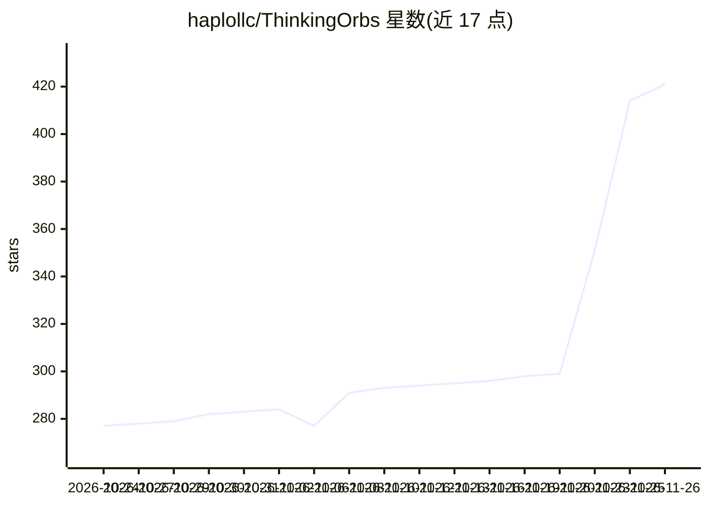

# haplollc/ThinkingOrbs

⭐ 421 · Swift · MIT · 推送 2026-11-06 · [GitHub](https://github.com/haplollc/ThinkingOrbs) · 个人维护

**面向 AI/Agent 界面的 SwiftUI 3D 点阵加载指示器库**

SwiftUI 组件包，提供九种手工调校的 3D 点阵加载动画和两种预设尺寸，用于表达 AI 应用与 Agent 的工作状态（搜索、推理、听写、工具调用、撰写回复等）。每个设计对应 OrbDesign 枚举的一个 case，支持自定义尺寸、速度、暂停、状态标签（带微光文字）、明暗适配与 Reduce Motion 无障碍处理；屏幕外自动停帧以省电。经 Swift Package Manager 一行引入，兼容 iOS/macOS/tvOS/watchOS/visionOS。动画几何移植自 Jakub Antalik 的 web 库，附差异测试验证。

## 筛选速览

| 维度 | 判定 | 备注 |
|---|---|---|
| AI 角色 | `ai-enhanced` | 去掉 AI 部分产品仍成立 |
| 许可风险 | `permissive` | MIT |
| 部署形态 | `None` |  |
| 模型依赖 | — | README 未给出锁定关系 |
| 硬件要求 | — | 无带数字的原话,不猜 |
| 安装摩擦 | `medium` | 含编译或系统依赖之一 |
| 成熟度 | — | 结构信号不足 |

## 能力要点

- 九种设计对应不同 Agent 状态（working/searching/solving/listening 等），另有 ThinkingOrbLabel 状态标签
- 两种独立调校的尺寸（64pt/20pt），支持任意直径与速度倍率
- 屏幕外自动停帧、后台暂停，含逐帧性能数据
- 几何公式级移植原 web 引擎，附 725,149 帧差异校验脚本

## 适用场景

- 给 iOS AI 助手加'正在思考/搜索'的加载动画
- 按 Agent 状态（推理/工具调用/撰写）切换对应动画
- 聊天界面的'对方正在输入'气泡与状态栏指示

## 场景标签

 · 领域:移动/客户端 UI 组件

## 证据(README 行号)

> L2: Dotted, genuinely 3D loading indicators for AI and agent interfaces in SwiftUI: nine hand-tuned designs, two tuned s
> L239: - iOS 17+, macOS 14+, tvOS 17+, watchOS 10+, visionOS 1+

## 星数曲线

2026-10-24 277 → 2026-11-26 421（+144）

---
*卡片 v1 · prompt 1.4 · 生成 2026-11-25 · 置信度 high · 依据 README sha `089521d848f4` · [字段定义](../../DATASET.md)*
