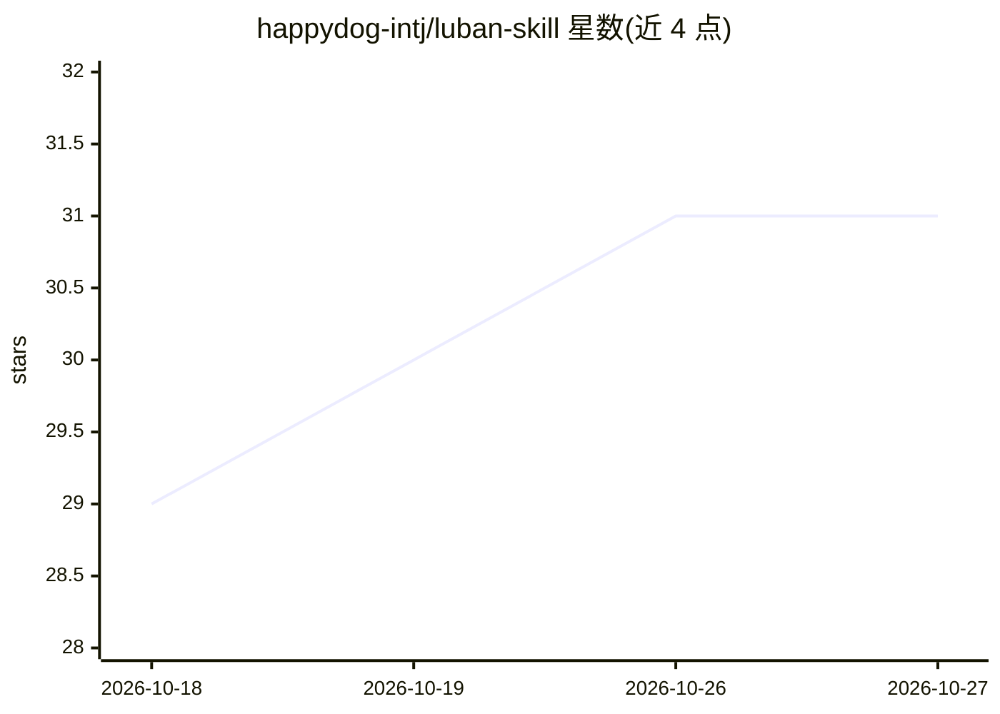

# happydog-intj/luban-skill

⭐ 31 · 推送 2026-08-17 · [GitHub](https://github.com/happydog-intj/luban-skill) · 个人维护 · 中文 README

**代码风格 Skill 库与蒸馏框架：提炼项目的编码 DNA 供 AI 加载**

提供一批以 SKILL.md 格式（OpenClaw AgentSkill 格式）编写的代码风格 Skill，覆盖 linux-kernel、vue3、pytorch、go-stdlib、rust-tokio 等 10 个项目风格，另有 16 位工程师视角的 Reviewer 系列 Skill。核心机制：由鲁班框架本身分析目标项目的命名哲学、架构偏好、注释约定与反模式，输出可加载到 Claude Code / Cursor / Copilot 系统提示的风格 Prompt；用户也可粘贴代码或提供 GitHub 链接蒸馏新 Skill。限制：Skill 为 Markdown 提示文本，依赖外部 AI 工具运行，无独立可执行程序。MIT 许可。

## 筛选速览

| 维度 | 判定 | 备注 |
|---|---|---|
| AI 角色 | `ai-knowledge` | 知识聚合/清单类 |
| 许可风险 | `none` | — |
| 部署形态 | `None` |  |
| 模型依赖 | — | README 未给出锁定关系 |
| 硬件要求 | — | 无带数字的原话,不猜 |
| 安装摩擦 | `low` | 无编译、无系统依赖或容器化 |
| 成熟度 | — | 结构信号不足 |

## 能力要点

- 10 个项目级代码风格 Skill（linux-kernel/pytorch/rust-tokio 等）
- 16 位工程师视角的 Reviewer 系列 Skill（Linus/DHH/Karpathy 等）
- 鲁班框架可分析任意代码库蒸馏出新 Skill
- SKILL.md 遵循 OpenClaw AgentSkill 格式，可被多种 AI 工具加载

## 适用场景

- 写新代码时让 AI 自动对齐目标项目的编码风格
- 让 AI 以特定工程师视角审查我的代码
- 把团队或开源项目的编码约定蒸馏成可复用的 Skill

## 场景标签

`提示工程` `代码审查` · 领域:Agent 开发

## 证据(README 行号)

> L36: 鲁班.skill 用同样的逻辑做代码：**提炼任何代码库的编码 DNA，生成可运行的风格 Skill**，让 AI 在写新代码时自动对齐目标风格。
> L120: `SKILL.md` 遵循 OpenClaw AgentSkill 格式，可直接被 AI 工具加载。

## 星数曲线

2026-10-18 29 → 2026-10-27 31（+2）

---
*卡片 v1 · prompt 1.4 · 生成 2026-10-26 · 置信度 high · 依据 README sha `1c16b313bafb` · [字段定义](../../DATASET.md)*
