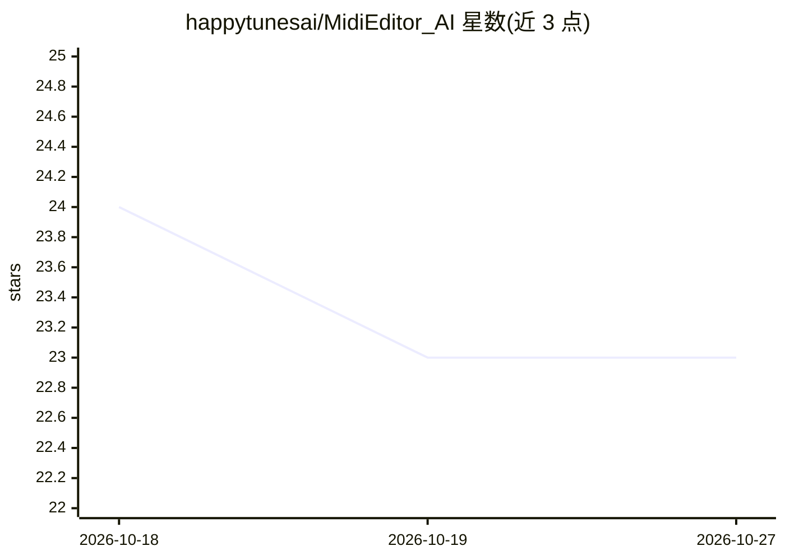

# happytunesai/MidiEditor_AI

⭐ 23 · C++ · GPL-3.0 · 推送 2026-10-25 · [GitHub](https://github.com/happytunesai/MidiEditor_AI) · [官网](https://midieditor-ai.de/) · 个人维护

**带 AI 副驾驶的 Windows MIDI 编辑器，自然语言作曲改谱**

免费 GPL-3.0 的 Windows 桌面 MIDI 编辑器，基于 Meowchestra/MidiEditor 分支，功能包括钢琴卷帘编辑、MIDI 录制与播放、内置 FluidSynth、音频导出（WAV/FLAC/OGG/MP3）、Guitar Pro/MusicXML/MuseScore 导入、Commodore 64 SID 文件支持与 FFXIV 吟游诗人演奏约束工具。其中 AI 部分 MidiPilot 副驾驶：通过自然语言对话作曲、编辑、变换与分析 MIDI，支持 Agent 多步工具调用模式，可接入 OpenAI、OpenRouter、Gemini、Ollama 等多提供商，并内置 MCP 服务器供 Claude Desktop、Cursor 等客户端操作 MIDI。以 GitHub Releases 的 zip 包提供安装。

## 筛选速览

| 维度 | 判定 | 备注 |
|---|---|---|
| AI 角色 | `ai-enhanced` | 去掉 AI 部分产品仍成立 |
| 许可风险 | `viral` | GPL-3.0 |
| 部署形态 | `desktop` | 安装包/桌面程序 |
| 模型依赖 | local-ok | 支持本地模型 |
| 硬件要求 | — | 无带数字的原话,不猜 |
| 安装摩擦 | `medium` | 含编译或系统依赖之一 |
| 成熟度 | — | 结构信号不足 |

## 能力要点

- MidiPilot AI 副驾驶：自然语言作曲/编辑/变换/分析 MIDI，Agent 多步工具调用与逐工具撤销
- 多提供商支持：OpenAI、OpenRouter、Google Gemini、Ollama 及任意 OpenAI 兼容端点
- 内置 MCP 服务器，Claude Desktop、VS Code Copilot、Cursor 可直接编辑 MIDI
- FFXIV Bard 模式：演奏约束、鼓分轨、声部上限审计与可玩性检查
- Guitar Pro/MusicXML/MuseScore 导入与 MusicXML 导出，SID 文件经 libsidplayfp 播放

## 适用场景

- 用自然语言让 AI 帮我作曲、改编和分析 MIDI 文件
- 为 FFXIV 游戏内演奏准备符合约束的乐谱
- 让 Claude Desktop 或 Cursor 通过 MCP 直接编辑我的 MIDI 工程

## 场景标签

 · 领域:音乐/桌面工具

## 证据(README 行号)

> L23: MidiEditor AI is a free MIDI editor with **MidiPilot** - an integrated AI copilot that can compose, arrange, analyz
> L50: |🤖 **MidiPilot AI Copilot**|Compose, edit, and transform MIDI via natural language chat with live Agent streaming|

## 星数曲线

2026-10-18 24 → 2026-10-27 23（-1）

---
*卡片 v1 · prompt 1.4 · 生成 2026-10-27 · 置信度 high · 依据 README sha `52204260f8a4` · [字段定义](../../DATASET.md)*
