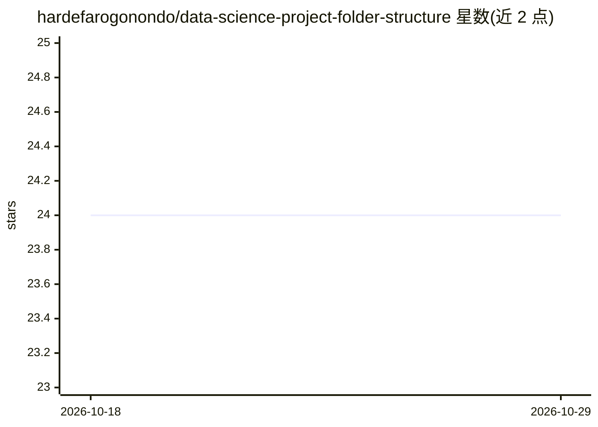

# hardefarogonondo/data-science-project-folder-structure

⭐ 24 · Jupyter Notebook · Apache-2.0 · 推送 2026-04-17 · [GitHub](https://github.com/hardefarogonondo/data-science-project-folder-structure) · 个人维护

**数据科学项目目录结构模板：从原始数据到模型部署的标准化布局**

提供一套标准化的数据科学项目目录布局说明，覆盖 data、docs、models、notebooks、references、reports、src 七个顶层目录，并在 README 中逐项说明用途：raw/processed 数据分离、按工作流阶段编号的 notebooks（数据准备、EDA、特征工程、训练评估）、模型与日志存放、文档与报告归档。面向数据科学从业者与学习者，作为可复制的项目初始结构使用；不提供代码、依赖或工具，仅是结构约定文档，安装方式即 fork 并 git clone。

## 筛选速览

| 维度 | 判定 | 备注 |
|---|---|---|
| AI 角色 | `ai-knowledge` | 知识聚合/清单类 |
| 许可风险 | `permissive` | Apache-2.0 |
| 部署形态 | `None` |  |
| 模型依赖 | — | README 未给出锁定关系 |
| 硬件要求 | — | 无带数字的原话,不猜 |
| 安装摩擦 | `low` | 无编译、无系统依赖或容器化 |
| 成熟度 | — | 结构信号不足 |

## 能力要点

- 七个顶层目录的标准化布局（data/docs/models/notebooks/references/reports/src）
- notebooks 按数据科学工作流四阶段编号组织
- raw 与 processed 数据分离以保留可追溯性

## 适用场景

- 新建数据科学项目时复制此目录结构作为起点
- 团队统一项目目录规范，便于协作与交接
- 按阶段整理 Jupyter notebooks 与模型日志

## 场景标签

 · 领域:数据科学/工程实践

## 证据(README 行号)

> L3: Discover a standardized Data Science project directory layout in this repository, crafted in line with industry-lead
> L9: This structure is crafted to guide every data science professional and enthusiast through a streamlined workflow, ri

## 星数曲线

2026-10-18 24 → 2026-10-29 24（+0）

---
*卡片 v1 · prompt 1.4 · 生成 2026-10-27 · 置信度 mid · 依据 README sha `370c1a507380` · [字段定义](../../DATASET.md)*
