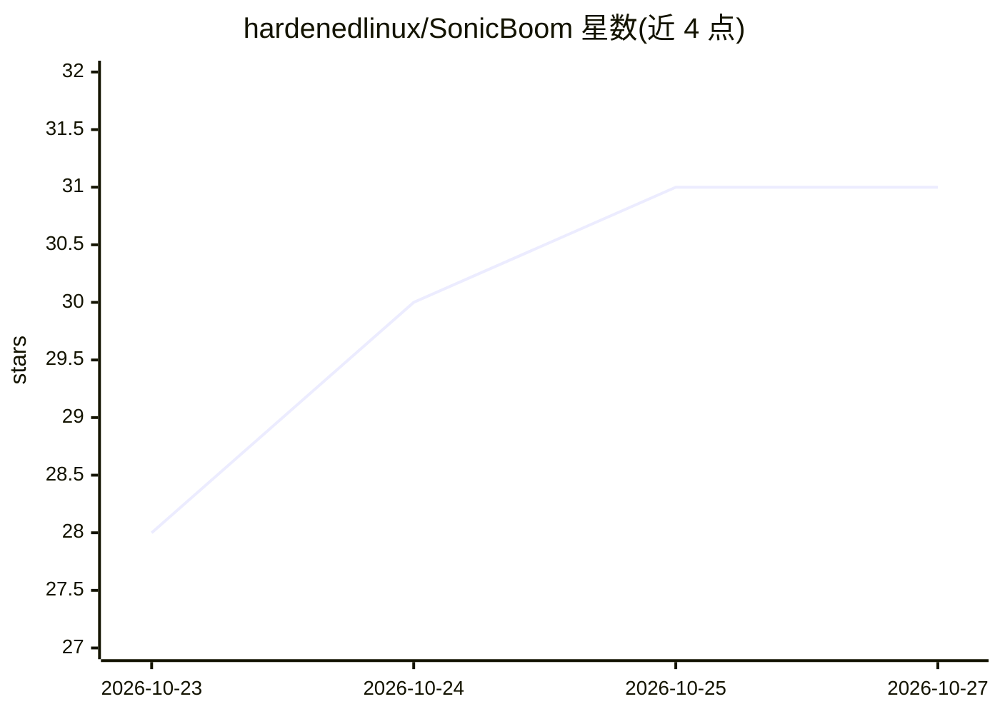

# hardenedlinux/SonicBoom

⭐ 31 · C++ · GPL-3.0 · 推送 2026-10-25 · [GitHub](https://github.com/hardenedlinux/SonicBoom) · 组织维护 · 中文 README

**C++/CUDA 原生张量运行时，面向消费级 GPU 的本地 LLM 推理**

用 C++/CUDA 从零编写的张量框架与 LLM 推理运行时，无 Python 依赖，通过稳定 C ABI 暴露为单个 libsonicboom.so，GNU Guile 为一等语言。内部含图规划器与 MLIR 编译层（可生成 GPU kernel），每个 decode 步骤以单次 CUDA Graph replay 执行，KV cache 常驻显存，前缀缓存复用与全量重算逐 token 一致。读取 GGUF 模型，v0.0.3 仅在 sm_86（RTX 30 系）上构建并验证了 Gemma 4 E4B-it 与 Qwen2.5-0.5B 两个模型。需从源码编译，依赖 CUDA toolkit、Guile 3.0 与构建期工具 SonicCross；LLVM/MLIR 为必需。GPL-3.0-or-later。

## 筛选速览

| 维度 | 判定 | 备注 |
|---|---|---|
| AI 角色 | `ai-ecosystem` | LLM/agent 周边工具 |
| 许可风险 | `viral` | GPL-3.0 |
| 部署形态 | `None` |  |
| 模型依赖 | — | README 未给出锁定关系 |
| 硬件要求 | — | 无带数字的原话,不猜 |
| 安装摩擦 | `high` | 编译与系统依赖俱全 |
| 成熟度 | `idea` | |

## 能力要点

- 无 Python 的 C ABI 单库设计，Guile 为一等绑定语言
- MLIR 编译层生成 GPU kernel（融合算子、attention、bf16 GEMM）
- decode 步骤单次 CUDA Graph replay，KV cache 常驻设备，前缀复用逐 token 精确
- 支持按 GPU 运行时自动调优与无损投机解码（默认关闭）

## 适用场景

- 在消费级 NVIDIA GPU 上本地运行 GGUF 量化 LLM 推理
- 需要可审计、无 Python 依赖链的可链接推理运行时
- 用 Scheme 编写并编译张量计算图（通用张量框架用途）

## 场景标签

`推理引擎` · 领域:训练与推理

## 证据(README 行号)

> L5: SonicBoom is an AI framework written from the ground up in C++ and CUDA,
> L59: **More than an LLM runner.** SonicBoom is a general tensor framework: a
> L62: defined in the C++ core and served from any language. LLM inference is the first

## 星数曲线

2026-10-23 28 → 2026-10-27 31（+3）

---
*卡片 v1 · prompt 1.4 · 生成 2026-10-26 · 置信度 high · 依据 README sha `5b4ace03127b` · [字段定义](../../DATASET.md)*
