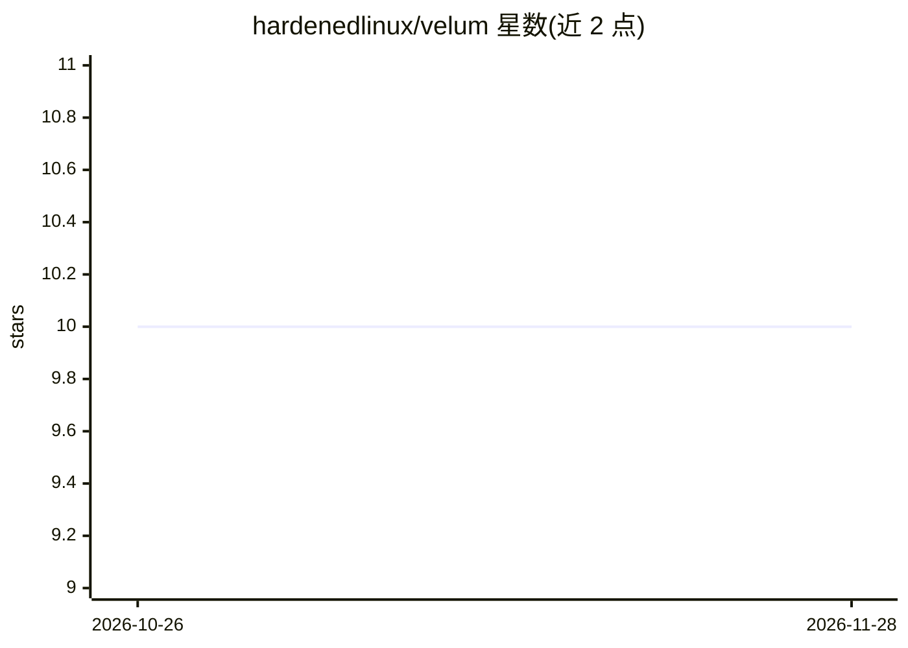

# hardenedlinux/velum

⭐ 10 · C++ · GPL-3.0 · 推送 2026-10-18 · [GitHub](https://github.com/hardenedlinux/velum) · 组织维护 · 中文 README

**无 Python 运行时的 CosyVoice3 语音合成 C++ 实现**

对 CosyVoice3 文本转语音管线的原生重实现：LLM（Qwen2-0.5B）、Flow DiT 解码器与 HiFT 声码器在 GGML 上运行，支持 CUDA 加速并在无 GPU 时回退 CPU；权重转换与声学前端离线一次性用 Python 完成并冻结为文件。以单个可执行二进制形式部署，提供 CLI 从文本合成 .wav，支持种子控制、文件输入与分段指令合成。社区版缺失的 ONNX 前端等功能由企业版咨询服务提供。

## 筛选速览

| 维度 | 判定 | 备注 |
|---|---|---|
| AI 角色 | `ai-native` | 本体是模型或模型工具 |
| 许可风险 | `viral` | GPL-3.0 |
| 部署形态 | `library` | 以包/库形式分发 |
| 模型依赖 | — | README 未给出锁定关系 |
| 硬件要求 | `cpu-ok` | |
| 安装摩擦 | `high` | 编译与系统依赖俱全 |
| 成熟度 | — | 结构信号不足 |

## 能力要点

- LLM/Flow/HiFT 三阶段均在 GGML 上运行，运行时零 Python 依赖
- CUDA 自动检测并回退 CPU 后端，可用 VELUM_BACKEND=cpu 强制 CPU
- 权重从 HuggingFace 固定版本下载并经 SHA-256 校验后转为 GGUF
- 支持分段 JSON 输入，每段可带独立合成指令并插入静音间隔

## 适用场景

- 将 TTS 打包为单二进制部署到生产环境
- 中文文本生成 .wav 语音文件
- 对长文本按句分段并指定不同语气指令合成

## 场景标签

`语音合成` · 领域:内容生成

## 证据(README 行号)

> L3: A native reimplementation of the CosyVoice3 text-to-speech pipeline with **zero
> L4: Python at runtime**. The neural networks (LLM / Flow / HiFT) run on
> L35: The end-to-end CLI (LLM → Flow → HiFT) is wired and cross-checked by

## 星数曲线

2026-10-26 10 → 2026-11-28 10（+0）

---
*卡片 v1 · prompt 1.4 · 生成 2026-11-19 · 置信度 mid · 依据 README sha `d263c0d827cf` · [字段定义](../../DATASET.md)*
