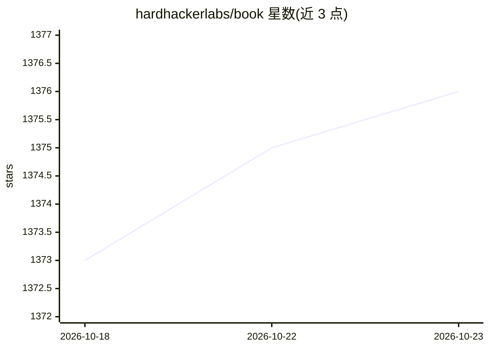

# hardhackerlabs/book

⭐ 1,376 · MDX · 推送 2026-08-08 · [GitHub](https://github.com/hardhackerlabs/book) · [官网](https://t.zsxq.com/19SKbmflB) · 组织维护 · 中文 README

**记录 Podwise 产品历程的独立开发者实践书籍**

由硬地骇客团队编著的电子书，忠实记录 AI 播客知识管理产品 Podwise 从灵感到变现的过程。全书按产品生命周期分灵感、构建、发布、增长、复盘五章，内容涉及利基市场选择、MVP、技术栈、大模型使用、获客与定价等。作者为三位 10 年+ 互联网创业者组成的社区，本书采用 CC BY-NC-ND 4.0 许可，并通过知识星球提供配套讨论社群。

## 筛选速览

| 维度 | 判定 | 备注 |
|---|---|---|
| AI 角色 | `ai-knowledge` | 知识聚合/清单类 |
| 许可风险 | `none` | — |
| 部署形态 | `None` |  |
| 模型依赖 | — | README 未给出锁定关系 |
| 硬件要求 | — | 无带数字的原话,不猜 |
| 安装摩擦 | `low` | 无编译、无系统依赖或容器化 |
| 成熟度 | — | 结构信号不足 |

## 能力要点

- 按产品全生命周期分为灵感、构建、发布、增长、复盘五部分
- 记录 Podwise（AI 播客转录/总结/知识管理产品）的真实历程
- 配套知识星球社群与播客内容
- CC BY-NC-ND 4.0 许可，可非商业分享

## 适用场景

- 独立开发者参考 AI 产品从 0 到变现的实践记录
- 了解利基市场选择、MVP 与增长运营的一手复盘
- 加入社群与作者及其他 Builder 讨论产品经验

## 场景标签

`教程课程` · 领域:学习与行业

## 证据(README 行号)

> L32: 本书是关于 Podwise 产品从灵感到变现过程的忠实记录以及复盘。
> L38: 全书以产品的全生命周期划分为 5 个部分：

## 星数曲线

2026-10-18 1,373 → 2026-10-23 1,376（+3）

---
*卡片 v1 · prompt 1.4 · 生成 2026-10-21 · 置信度 high · 依据 README sha `47f636b0855b` · [字段定义](../../DATASET.md)*
