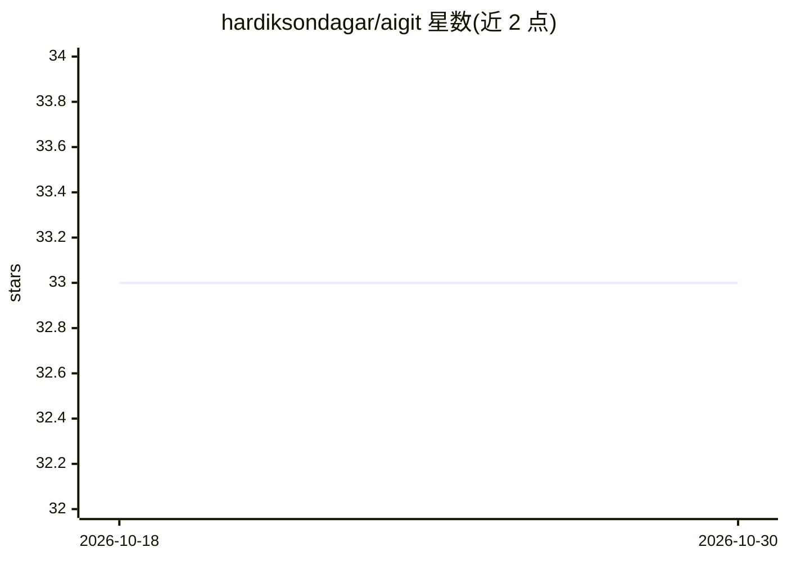

# hardiksondagar/aigit

⭐ 33 · Python · MIT · 推送 2025-11-29 · [GitHub](https://github.com/hardiksondagar/aigit) · 个人维护

**AI 驱动的 Git CLI：自动生成提交信息、分支名与 PR 描述**

面向开发者的 Python 命令行工具，基于 OpenAI API（默认 gpt-4o-mini）从 staged diff 生成符合 Conventional Commits 的提交信息、描述性分支名、PR 标题与描述，并提供 AI 代码审查（缺陷/安全/风格）与变更解释。通过 GitHub Token（repo 权限）创建 PR。安装支持 pipx 或 pip 从源码安装，配置存储于 ~/.config/aigit/config.toml。需 Python 3.10+、Git、OpenAI API key 与 GitHub token。

## 筛选速览

| 维度 | 判定 | 备注 |
|---|---|---|
| AI 角色 | `ai-native` | 本体是模型或模型工具 |
| 许可风险 | `permissive` | MIT |
| 部署形态 | `library` | 以包/库形式分发 |
| 模型依赖 | — | README 未给出锁定关系 |
| 硬件要求 | — | 无带数字的原话,不猜 |
| 安装摩擦 | `low` | 无编译、无系统依赖或容器化 |
| 成熟度 | — | 结构信号不足 |

## 能力要点

- 从 diff 生成 Conventional Commits 格式提交信息
- AI 生成分支名与 PR 标题/描述并通过 GitHub Token 创建 PR
- AI 代码审查（缺陷/安全/风格）与变更解释
- pipx 全局安装或 pip 源码安装，配置文件 ~/.config/aigit/config.toml

## 适用场景

- 我不想手写提交信息，让 AI 按 diff 生成规范提交
- 自动起分支名并生成完整 PR 描述
- 提交前让 AI 审查代码的缺陷、安全与风格问题

## 场景标签

`代码审查` · 领域:编码与开发

## 证据(README 行号)

> L7: > AI-powered Git CLI tool for smart commits, branches, and PRs
> L29: - 🤖 **AI Commit Messages**: Generate conventional commit messages from your diffs
> L31: - 🔀 **PR Automation**: Create pull requests with AI-generated titles and descriptions

## 星数曲线

2026-10-18 33 → 2026-10-30 33（+0）

---
*卡片 v1 · prompt 1.4 · 生成 2026-10-26 · 置信度 high · 依据 README sha `c3f62b4fc757` · [字段定义](../../DATASET.md)*
