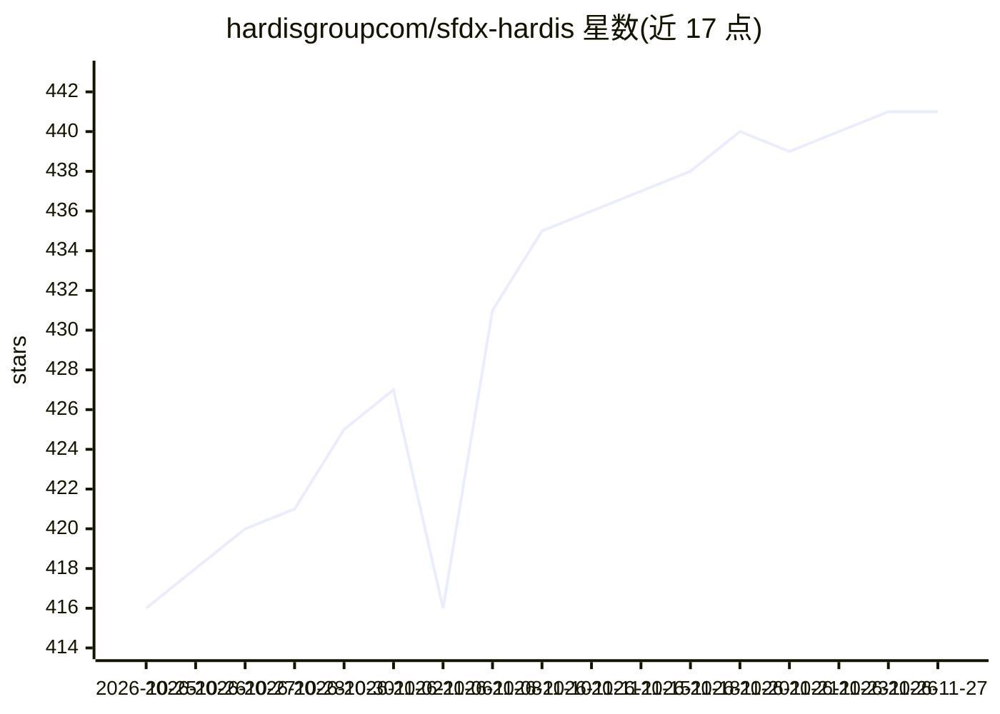

# hardisgroupcom/sfdx-hardis

⭐ 441 · TypeScript · AGPL-3.0 · 推送 2026-11-26 · [GitHub](https://github.com/hardisgroupcom/sfdx-hardis) · [官网](https://sfdx-hardis.cloudity.com) · 组织维护

**面向 Salesforce 管理员/开发者的 DevOps CLI 工具箱**

Cloudity 出品的 Salesforce CLI 插件与 VS Code 扩展套件：编排基础命令并提供交互式向导，支持定义完整 CI/CD 流水线、每日元数据备份与 org 监控（含 Grafana 面板）、AI 生成的项目文档。原生兼容主流 Git 平台、消息工具、工单系统与 AI 提供商，并提供免费的 Salesforce DevOps 实操课程与徽章。三种安装方式：VS Code 扩展、Salesforce CLI 插件、CI/CD 用的 Docker 镜像（含预装编码 agent CLI 的变体）。

## 筛选速览

| 维度 | 判定 | 备注 |
|---|---|---|
| AI 角色 | `ai-enhanced` | 去掉 AI 部分产品仍成立 |
| 许可风险 | `viral` | AGPL-3.0 |
| 部署形态 | `self-host` | docker 或自建部署 |
| 模型依赖 | — | README 未给出锁定关系 |
| 硬件要求 | — | 无带数字的原话,不猜 |
| 安装摩擦 | `low` | 无编译、无系统依赖或容器化 |
| 成熟度 | — | 结构信号不足 |

## 能力要点

- 提供 CI/CD 流水线定义与每日元数据备份、org 监控（Grafana 面板）
- AI 生成项目文档，with-agents 镜像预装 Claude/Codex/Gemini/Copilot CLI 支持 AI 自动修复
- 三种安装路径：VS Code 扩展、sf plugins install、Docker 镜像
- 附带免费实操课程（27 个实验，3 个等级）与可分享徽章

## 适用场景

- 为 Salesforce 项目搭建 CI/CD 流水线
- 每日自动备份 Salesforce 元数据并监控 org 状态
- 用 AI 生成并维护项目文档
- 通过 VS Code 菜单向导替代命令行完成日常管理工作

## 场景标签

 · 领域:DevOps/低代码平台工具链

## 证据(README 行号)

> L18: Sfdx-hardis is a **CLI and visual productivity tools suite for Salesforce**, by **Cloudity** & friends, natively co
> L32: - Generate your **Project Documentation** with AI
> L184: - **With-agents images** (`sfdx-hardis-with-agents`, `sfdx-hardis-ubuntu-with-agents`): Same as standard + coding 

## 星数曲线

2026-10-25 416 → 2026-11-27 441（+25）

---
*卡片 v1 · prompt 1.4 · 生成 2026-11-26 · 置信度 high · 依据 README sha `56ad9f81cc19` · [字段定义](../../DATASET.md)*
