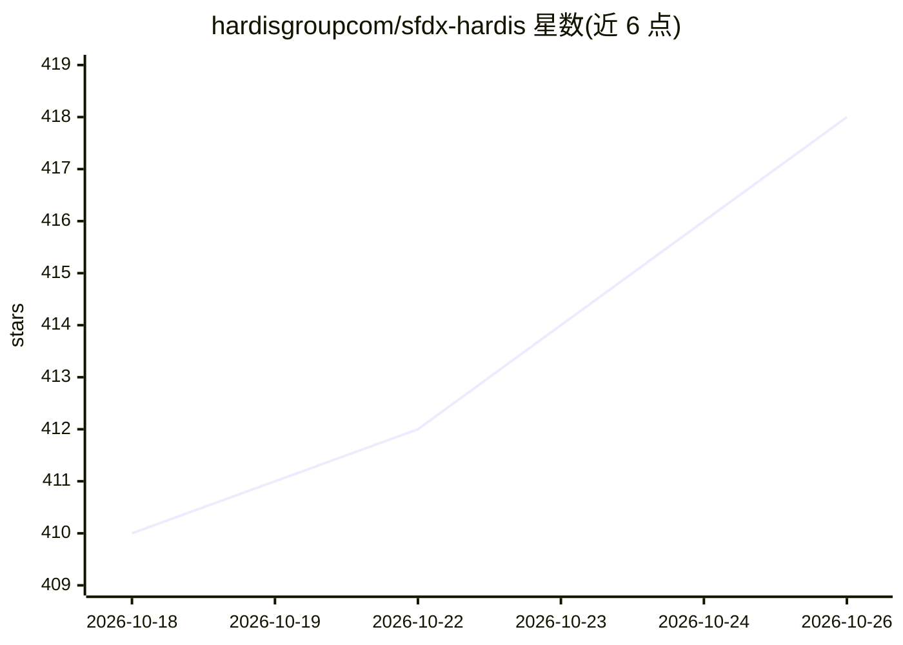

# hardisgroupcom/sfdx-hardis

⭐ 418 · TypeScript · AGPL-3.0 · 推送 2026-10-24 · [GitHub](https://github.com/hardisgroupcom/sfdx-hardis) · [官网](https://sfdx-hardis.cloudity.com) · 组织维护

**Salesforce DevOps 工具套件：CI/CD 流水线、元数据备份监控与 AI 文档生成**

由 Cloudity 维护的 Salesforce CLI 插件与 VS Code 扩展套件，面向 Salesforce 管理员与开发者。提供 DevOps 流水线（支持 GitHub/GitLab/Azure/Bitbucket）、元数据每日备份与 Grafana 监控、批量生产力命令、免费实操课程与徽章。AI 相关功能包括 AI 生成的组织文档、与 Agentforce 等 AI 提供商的原生集成，以及基于 Docker with-agents 镜像的 AI 编码代理自动修复（预装 Claude Code、Codex、Gemini CLI、GitHub Copilot）。三种安装方式：VS Code 扩展、CLI 插件、Docker 镜像。

## 筛选速览

| 维度 | 判定 | 备注 |
|---|---|---|
| AI 角色 | `ai-enhanced` | 去掉 AI 部分产品仍成立 |
| 许可风险 | `viral` | AGPL-3.0 |
| 部署形态 | `self-host` | docker 或自建部署 |
| 模型依赖 | — | README 未给出锁定关系 |
| 硬件要求 | — | 无带数字的原话,不猜 |
| 安装摩擦 | `low` | 无编译、无系统依赖或容器化 |
| 成熟度 | — | 结构信号不足 |

## 能力要点

- Salesforce CI/CD 流水线编排与 Pull Request 集成
- 元数据每日备份与基于 Grafana 的组织监控
- AI 生成项目文档与 AI 提供商原生集成（含 Agentforce）
- with-agents Docker 镜像预装 4 种编码代理 CLI 用于自动修复

## 适用场景

- 为 Salesforce 项目搭建完整的 CI/CD 流水线
- 定时备份元数据并监控组织状态
- 自动生成项目文档
- 用 AI 编码代理自动修复部署问题

## 场景标签

`AI 写作` · 领域:内容生成

## 证据(README 行号)

> L18: Sfdx-hardis is a **CLI and visual productivity tools suite for Salesforce**, by **Cloudity** & friends, natively co
> L24: - Deliver your projects with **State of the art Salesforce DevOps**
> L32: - Generate your **Project Documentation** with AI

## 星数曲线

2026-10-18 410 → 2026-10-26 418（+8）

---
*卡片 v1 · prompt 1.4 · 生成 2026-10-21 · 置信度 mid · 依据 README sha `3b8e70f2d312` · [字段定义](../../DATASET.md)*
