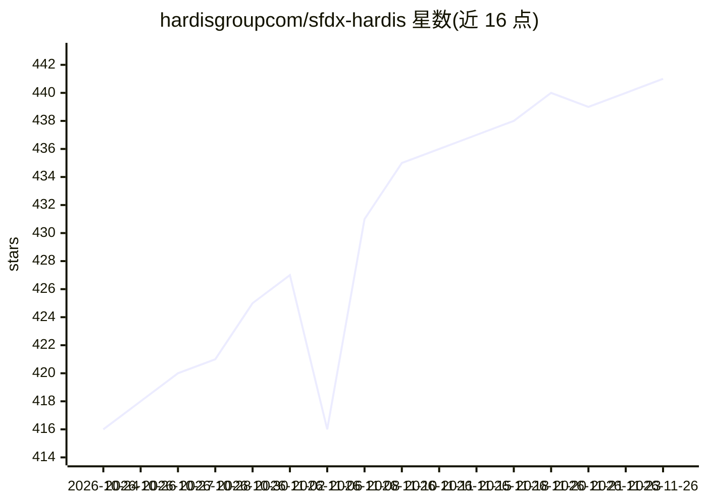

# hardisgroupcom/sfdx-hardis

⭐ 441 · TypeScript · AGPL-3.0 · 推送 2026-11-25 · [GitHub](https://github.com/hardisgroupcom/sfdx-hardis) · [官网](https://sfdx-hardis.cloudity.com) · 组织维护

**面向 Salesforce 管理员/开发者的 CLI 与 CI/CD 工具箱**

Cloudity 出品的 Salesforce CLI 插件与 VS Code 扩展套件，在原生 Salesforce CLI 之上编排命令并提供交互式向导；支持定义完整 CI/CD 流水线、定时元数据备份与 org 监控（配 Grafana）、AI 生成项目文档，以及借助预装编码 agent CLI 的 Docker 镜像做 AI 自动修复。提供三种安装方式：VS Code 扩展、Salesforce CLI 插件、CI/CD Docker 镜像；依赖 Node.js、Git 与 Salesforce CLI，兼容主流 Git 平台与多种 AI 提供商（含 Agentforce）。

## 筛选速览

| 维度 | 判定 | 备注 |
|---|---|---|
| AI 角色 | `ai-enhanced` | 去掉 AI 部分产品仍成立 |
| 许可风险 | `viral` | AGPL-3.0 |
| 部署形态 | `self-host` | docker 或自建部署 |
| 模型依赖 | — | README 未给出锁定关系 |
| 硬件要求 | — | 无带数字的原话,不猜 |
| 安装摩擦 | `low` | 无编译、无系统依赖或容器化 |
| 成熟度 | — | 结构信号不足 |

## 能力要点

- 三种安装途径：VS Code 扩展、sf plugins 插件、CI/CD Docker 镜像
- with-agents 镜像预装 Claude Code、Codex、Gemini CLI、GitHub Copilot 用于 AI 自动修复
- CI/CD 流水线、每日元数据备份与 org 监控（Grafana 集成）
- AI 生成项目文档与免费 DevOps 课程

## 适用场景

- 为 Salesforce 项目搭建完整的 CI/CD 部署流水线
- 定时备份 org 元数据并监控配置漂移
- 用 AI 生成并维护项目文档
- 在 CI 中用编码 agent 自动修复部署错误

## 场景标签

`编码 Agent` · 领域:编码与开发

## 证据(README 行号)

> L18: Sfdx-hardis is a **CLI and visual productivity tools suite for Salesforce**, by **Cloudity** & friends, natively co
> L32: - Generate your **Project Documentation** with AI
> L218: These images include Claude Code, OpenAI Codex, Gemini CLI, and GitHub Copilot pre-installed and are required for 

## 星数曲线

2026-10-24 416 → 2026-11-26 441（+25）

---
*卡片 v1 · prompt 1.4 · 生成 2026-11-25 · 置信度 mid · 依据 README sha `bbb3099aa54b` · [字段定义](../../DATASET.md)*
