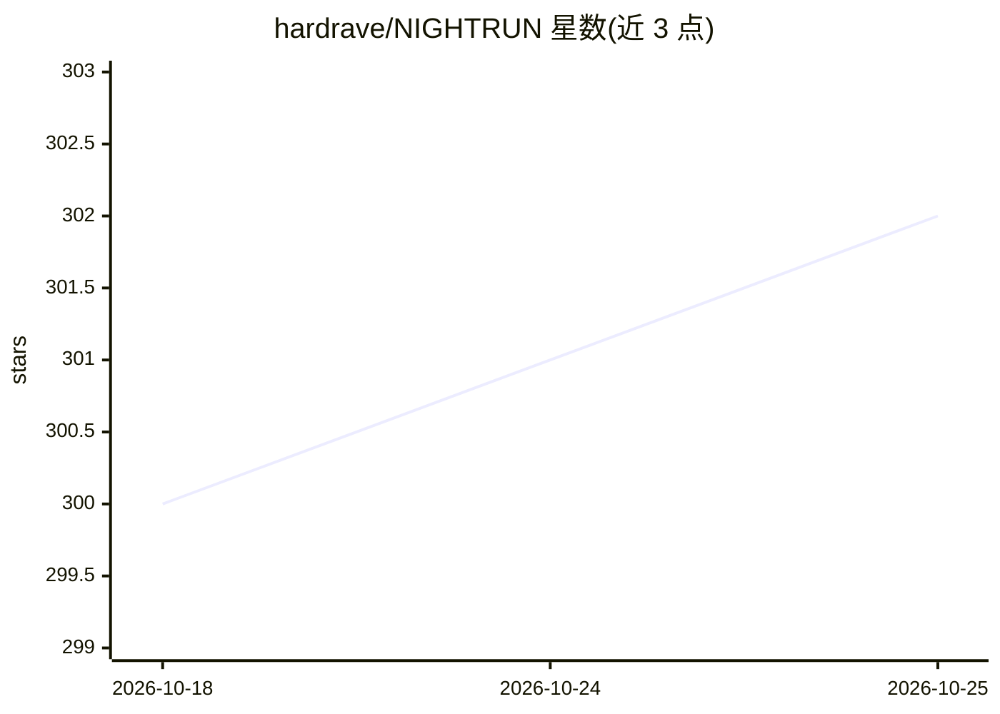

# hardrave/NIGHTRUN

⭐ 302 · Rust · NOASSERTION · 推送 2026-07-27 · [GitHub](https://github.com/hardrave/NIGHTRUN) · [官网](https://nightrun.io) · 个人维护

**无操作系统、直接从 UEFI 启动的本地 LLM 对话运行时**

用 Rust 编写的 UEFI 常驻应用：固件直接启动 NightRun，把量化模型（Llama 3.2 / Qwen3 / Granite，1.3–2.4 GB）流式载入 RAM 并逐段 CRC 校验，随后在 CPU 上离线运行推理，用户在自绘的 framebuffer 终端中对话。支持 x86_64 UEFI（USB 启动）与 Raspberry Pi 5（SD 卡），手写 AVX2/NEON 量化内核，greedy 输出逐 token 与 llama.cpp 对齐校验。自述为实验性系统软件，不支持 Legacy BIOS，新模型架构需引擎适配。

## 筛选速览

| 维度 | 判定 | 备注 |
|---|---|---|
| AI 角色 | `ai-native` | 本体是模型或模型工具 |
| 许可风险 | `none` | NOASSERTION |
| 部署形态 | `None` |  |
| 模型依赖 | — | README 未给出锁定关系 |
| 硬件要求 | — | 无带数字的原话,不猜 |
| 安装摩擦 | `low` | 无编译、无系统依赖或容器化 |
| 成熟度 | `idea` | |

## 能力要点

- 无 OS：UEFI 固件直接启动，模型全量驻留 RAM，生成期磁盘封禁
- 支持 Llama 3.2 / Qwen3 / Granite 4.1 三族模型，Q8_0/Q4_K/Q6_K 权重原地使用
- 贪心输出与 llama.cpp 逐 token 对齐，分词器与聊天模板经 fixture 固定校验
- 带保守设备检测与 SHA-256 验证的 USB/SD 刷写安装器

## 适用场景

- 从 U 盘启动一台机器直接与本地 LLM 对话，无需安装操作系统
- 在 Raspberry Pi 5 上离线运行小规模量化模型
- 体验无内核、无网络栈的单用途 LLM 推理系统

## 场景标签

`聊天机器人` `推理引擎` · 领域:对话与助手

## 证据(README 行号)

> L9: This is weird software. It boots straight into an LLM.
> L13: framebuffer, and you chat. No kernel, no browser, no network stack, no host process.
> L26: 6. You get a chat prompt. The model answers on your CPU, offline, forever.

## 星数曲线

2026-10-18 300 → 2026-10-25 302（+2）

---
*卡片 v1 · prompt 1.4 · 生成 2026-10-21 · 置信度 high · 依据 README sha `325d6146bb6f` · [字段定义](../../DATASET.md)*
