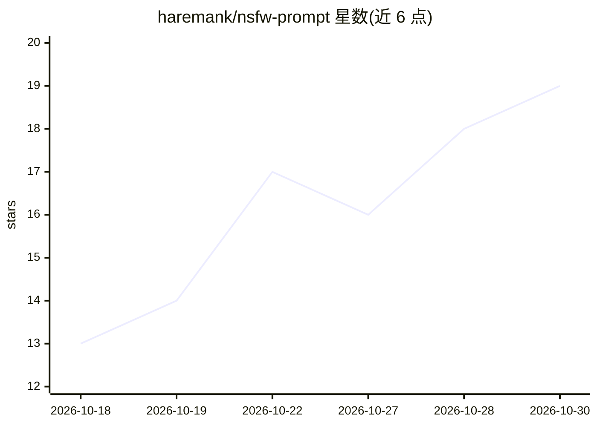

# haremank/nsfw-prompt

⭐ 19 · MIT · 推送 2026-09-02 · [GitHub](https://github.com/haremank/nsfw-prompt) · [官网](https://skills.sh/haremank/nsfw-prompt) · 个人维护 · 中文 README

**面向 Agent 的成人图像英文提示词编译技能（SKILL.md 格式）**

以 SKILL.md 格式分发的 Agent Skill：把中文成人图像需求编译成可复制的英文提示词，供 Grok Imagine、Flux、Z-Image、Pony、Illustrious、NovelAI、SDXL、SD1.5、Wan 视频、Midjourney/DALL·E 等 10+ 模型方言使用。机制为五档暴露（L1–L5）加私处子档（S1–S4），默认 L2，换模型不重写、只重渲中间表示。仅编译文本，不调用图像 API、不写越狱 payload；设未成年、真实私人、非自愿性暴力三条硬拒绝项。通过 npx skills add、git clone 或 ZIP 安装到各代理 skills 目录。

## 筛选速览

| 维度 | 判定 | 备注 |
|---|---|---|
| AI 角色 | `ai-ecosystem` | LLM/agent 周边工具 |
| 许可风险 | `permissive` | MIT |
| 部署形态 | `library` | 以包/库形式分发 |
| 模型依赖 | locked-api |  |
| 硬件要求 | — | 无带数字的原话,不猜 |
| 安装摩擦 | `low` | 无编译、无系统依赖或容器化 |
| 成熟度 | — | 结构信号不足 |

## 能力要点

- 中文提需求、输出可复制英文提示词，附带五行自审
- 五档暴露 × 私处子档（L1–L5 / S1–S4），默认 L2
- 10+ 模型方言适配，换模型只重渲中间表示
- 仅编译文本，不调图像 API、不写越狱 payload，三条硬底线一行拒绝

## 适用场景

- 在 Claude Code / Codex / OpenClaw 等代理中用中文需求编译各模型方言的英文提示词
- 在同一语法基础上切换暴露档位与目标模型
- 按平台方言（标签头/散文/NAI 标签）获得对应格式的提示词

## 场景标签

`提示工程` · 领域:Agent 开发

## 证据(README 行号)

> L3: **把成人图像需求编译成可复制英文提示词的 Agent Skill**
> L24: - **只编译文本** — 不画图、不调图像 API、不写越狱 payload

## 星数曲线

2026-10-18 13 → 2026-10-30 19（+6）

---
*卡片 v1 · prompt 1.4 · 生成 2026-10-29 · 置信度 high · 依据 README sha `df6d51a46d85` · [字段定义](../../DATASET.md)*
