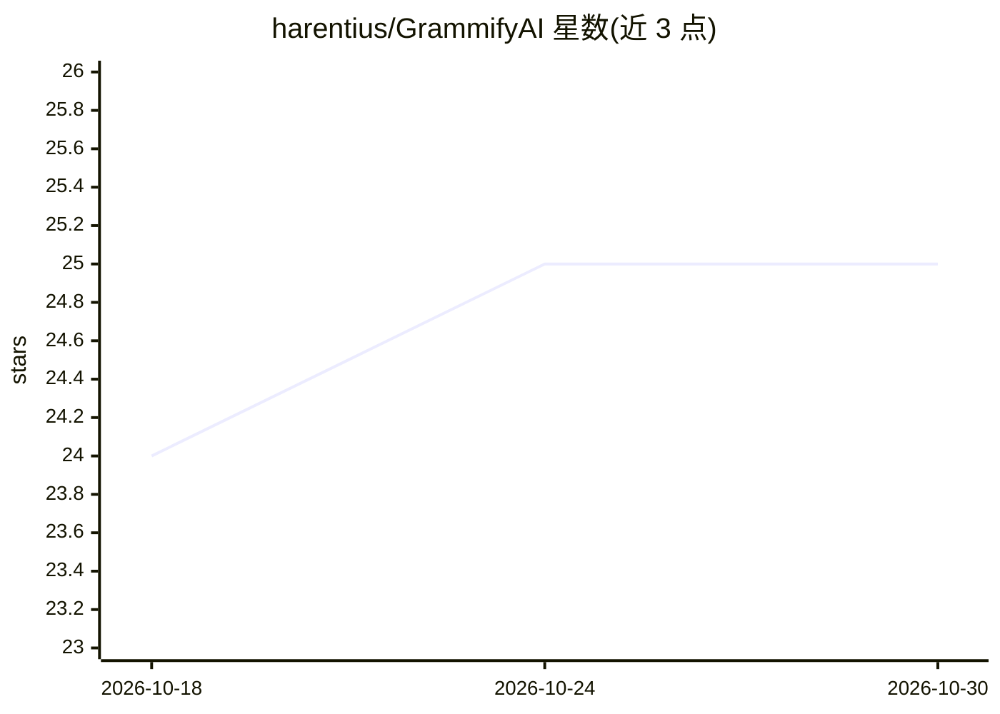

# harentius/GrammifyAI

⭐ 25 · Swift · MIT · 推送 2026-10-25 · [GitHub](https://github.com/harentius/GrammifyAI) · 个人维护

**macOS 全局文本语法检查工具：选中文本按快捷键即获 LLM 修正**

基于 macOS Accessibility API 的桌面工具：在任意网页或原生应用中选中文本并按快捷键（⌘+U 或自定义），弹出含改进建议的弹窗与 diff 视图，修正后文本自动复制到剪贴板可直接粘贴。使用用户自己的 LLM API key（任何 OpenAI 兼容 API，默认 OpenAI），无官方配额限制，用量取决于用户 API 计费；key 存于 macOS Keychain。已知限制：不支持 Google Docs；LLM 对敏感或细微话题可能改变原意。以 dmg/应用包形式安装，需授予 Accessibility 权限。

## 筛选速览

| 维度 | 判定 | 备注 |
|---|---|---|
| AI 角色 | `ai-native` | 本体是模型或模型工具 |
| 许可风险 | `permissive` | MIT |
| 部署形态 | `None` |  |
| 模型依赖 | — | README 未给出锁定关系 |
| 硬件要求 | — | 无带数字的原话,不猜 |
| 安装摩擦 | `low` | 无编译、无系统依赖或容器化 |
| 成熟度 | — | 结构信号不足 |

## 能力要点

- 经 Accessibility API 在任意网页/原生应用中取词，快捷键触发检查
- 修正建议以 diff 视图展示，修正文本自动复制到剪贴板
- 使用用户自有 OpenAI 兼容 API key，无产品侧配额，key 存于 Keychain

## 适用场景

- 在 Slack、Chrome、Notion 等应用中快速修正外语写作
- 学习外语时获得即时写作反馈而不需切换窗口对话
- 用自有 API key 替代订阅制语法服务的日常文本润色

## 场景标签

`AI 写作` · 领域:内容生成

## 证据(README 行号)

> L3: **Minimalist LLM Grammar Checker for macOS that works with any application and language.**
> L9: By leveraging **LLM integration** (e.g., OpenAI), it not only fixes grammar but also improves your writing style and

## 星数曲线

2026-10-18 24 → 2026-10-30 25（+1）

---
*卡片 v1 · prompt 1.4 · 生成 2026-10-27 · 置信度 high · 依据 README sha `be66f80de61d` · [字段定义](../../DATASET.md)*
