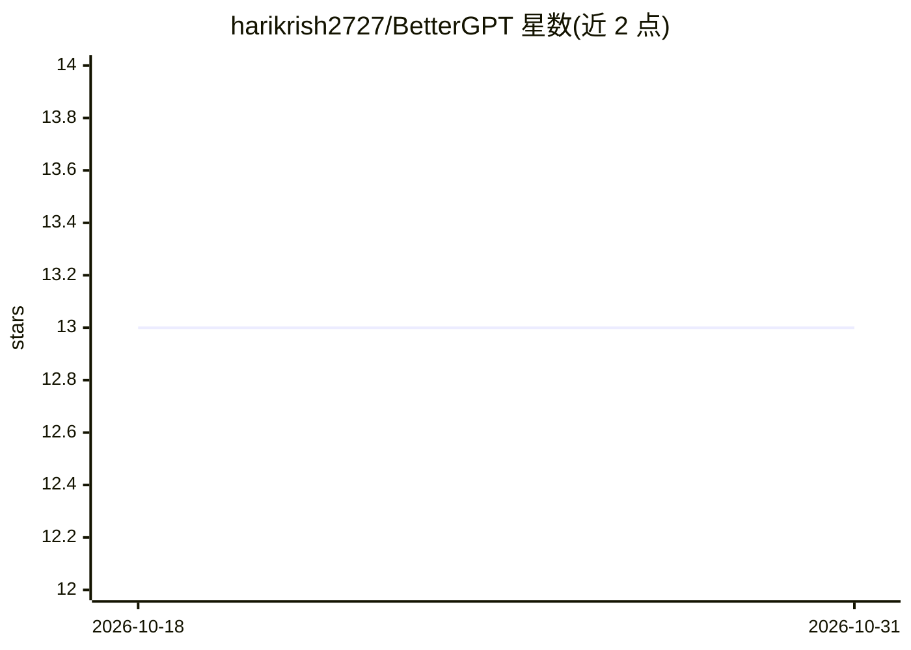

# harikrish2727/BetterGPT

⭐ 13 · Python · 推送 2026-07-29 · [GitHub](https://github.com/harikrish2727/BetterGPT) · 个人维护

**从零用 PyTorch 训练 decoder-only 语言模型的个人工程（152M）**

个人工程项目，用 PyTorch 手写现代 decoder-only Transformer 训练全流程：BPE 分词器、数据分片流水线、RoPE/RMSNorm/SwiGLU/SDPA 架构、预训练、评测与 Hugging Face 集成。当前 BetterGPT-150M（152M 参数）已在约 15B token 上完成预训练（FineWeb-Edu、Cosmopedia、FineMath、StarCoder-Python，两阶段 WSD 课程），权重托管于 Hugging Face，可通过 transformers AutoModelForCausalLM 加载，含 Space 在线演示。SFT 进行中，DPO 与部分评测项为计划状态；README 声明不与生产级 LLM 竞争，目标是学习实现。

## 筛选速览

| 维度 | 判定 | 备注 |
|---|---|---|
| AI 角色 | `ai-native` | 本体是模型或模型工具 |
| 许可风险 | `none` | — |
| 部署形态 | `None` |  |
| 模型依赖 | — | README 未给出锁定关系 |
| 硬件要求 | — | 无带数字的原话,不猜 |
| 安装摩擦 | `low` | 无编译、无系统依赖或容器化 |
| 成熟度 | `idea` | |

## 能力要点

- 152M 参数 decoder-only Transformer，约 15B token 两阶段 WSD 课程预训练
- RoPE/RMSNorm/SwiGLU/SDPA/权重绑定等现代架构组件从零实现
- Hugging Face 兼容（AutoModel/AutoModelForCausalLM、trust_remote_code 加载）
- lm-evaluation-harness 零样本评测：ARC/HellaSwag/PIQA/WinoGrande/SciQ 等

## 适用场景

- 学习现代 LLM 训练管线的每个组件如何从零实现
- 在 Hugging Face Space 或本地试用 152M 小语言模型
- 作为小规模预训练与指令微调（Alpaca SFT）的参考代码库

## 场景标签

`模型训练` `教程课程` · 领域:学习与行业

## 证据(README 行号)

> L3: BetterGPT is a personal engineering project to build a modern decoder-only Transformer from scratch, understanding a
> L5: **Current model: BetterGPT-150M** — a 152M-parameter decoder-only Transformer, pretrained from scratch on ~15B token
> L127: - **`BetterGPTModel`** — base transformer returning hidden states (`AutoModel`)

## 星数曲线

2026-10-18 13 → 2026-10-31 13（+0）

---
*卡片 v1 · prompt 1.4 · 生成 2026-10-31 · 置信度 high · 依据 README sha `c689c8d53c4b` · [字段定义](../../DATASET.md)*
