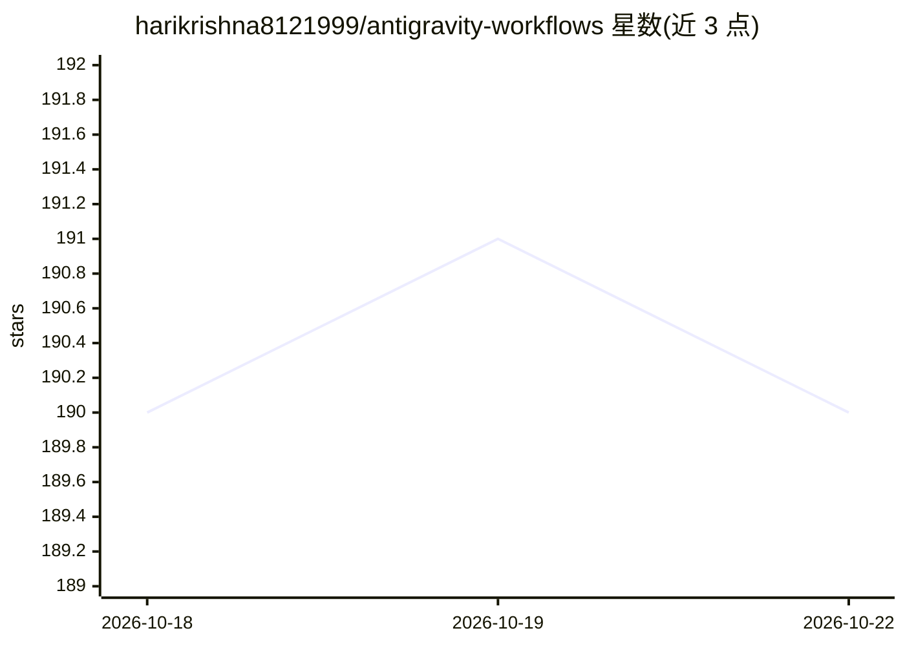

# harikrishna8121999/antigravity-workflows

⭐ 190 · JavaScript · NOASSERTION · 推送 2026-03-19 · [GitHub](https://github.com/harikrishna8121999/antigravity-workflows) · [官网](https://www.npmjs.com/package/antigravity-workflows) · 个人维护

**面向 Antigravity AI 编码助手的技术栈无关工作流集合**

社区维护的可复用工作流（类 Claude Skills）合集：以 Markdown 指令文件形式安装到项目 `.agent/workflows/` 目录，由 Antigravity 编码助手自动发现并执行。工作流遵循栈无关、提问驱动、渐进披露等原则，可检测项目框架后适配执行。覆盖约 40 个工作流，分为开发、Git 协作、测试质量、调试、安全、文档、部署、数据库、AI/LLM、创意 UI 十类。通过 npx 命令行按需安装，无需预先安装包。

## 筛选速览

| 维度 | 判定 | 备注 |
|---|---|---|
| AI 角色 | `ai-knowledge` | 知识聚合/清单类 |
| 许可风险 | `none` | NOASSERTION |
| 部署形态 | `library` | 以包/库形式分发 |
| 模型依赖 | — | README 未给出锁定关系 |
| 硬件要求 | — | 无带数字的原话,不猜 |
| 安装摩擦 | `low` | 无编译、无系统依赖或容器化 |
| 成熟度 | — | 结构信号不足 |

## 能力要点

- 约 40 个工作流，覆盖开发/Git/测试/安全/部署/数据库/AI 等十类任务
- 栈无关设计：检测或询问项目框架后适配，不强制特定技术栈
- npx antigravity-workflows install 按需安装到 .agent/workflows/
- 社区贡献流程与工作流模板，Apache 2.0 许可

## 适用场景

- 为 AI 编码助手配置可复用的规范工作流
- 生成符合约定的提交信息、PR 描述与单元测试
- 搭建 RAG 管道、AI agent 或设计 LLM 提示词

## 场景标签

 · 领域:AI 编码助手/工作流

## 证据(README 行号)

> L12: A collection of **intelligent workflows** that teach AI coding assistants how to perform tasks — without assuming y
> L19: **Think of it like anthropics/skills, but stack-agnostic.**
> L146: Workflows are installed to `.agent/workflows/` in your project:

## 星数曲线

2026-10-18 190 → 2026-10-22 190（+0）

---
*卡片 v1 · prompt 1.4 · 生成 2026-10-22 · 置信度 high · 依据 README sha `dee92e3048eb` · [字段定义](../../DATASET.md)*
