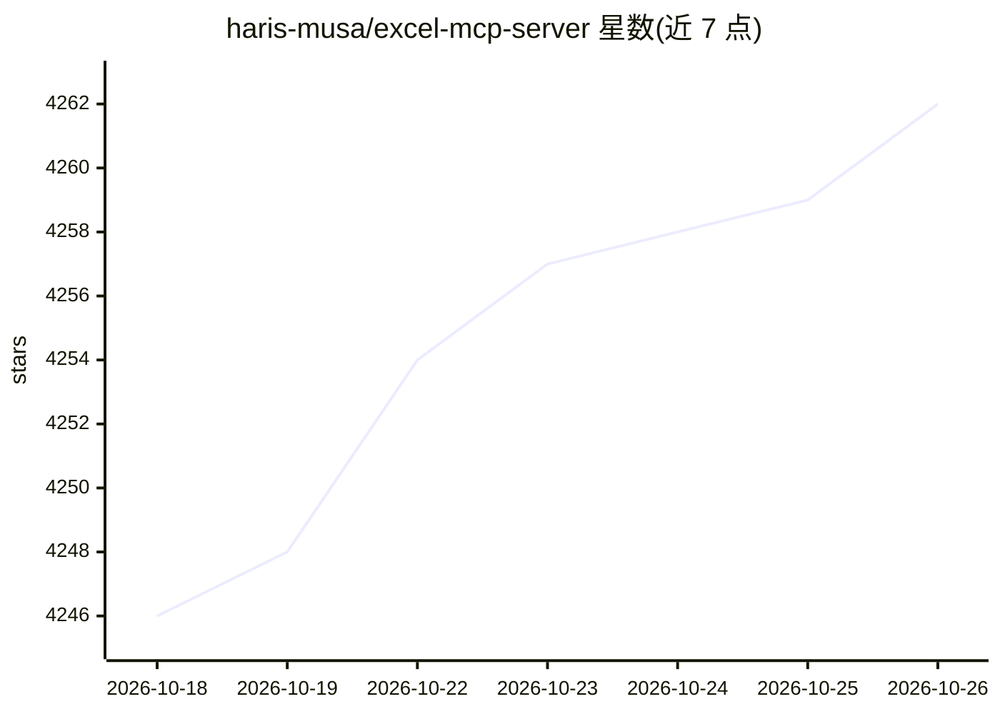

# haris-musa/excel-mcp-server

⭐ 4,262 · Python · MIT · 推送 2026-10-21 · [GitHub](https://github.com/haris-musa/excel-mcp-server) · [官网](https://excelmcpserver.com) · 个人维护

**让 AI 客户端读写 Excel 文件的 MCP 服务器，无需安装 Excel**

基于 openpyxl 的 Model Context Protocol 服务器，供 Claude、Cursor、VS Code Copilot、Codex、Gemini CLI、Devin 等 AI 客户端创建、读取和编辑 .xlsx/.xlsm/.xltx/.xltm 文件：支持约 20 类图表、可刷新的 PivotTable 与切片器、内置公式引擎（约 260 个函数）、条件格式、数据验证、CSV 导入导出。通过 uvx 运行，支持 stdio 与 Streamable HTTP（可 Docker 部署），提供文件夹限定、只读模式、原子保存等安全机制；读写 VBA 需显式开启且默认不运行宏。

## 筛选速览

| 维度 | 判定 | 备注 |
|---|---|---|
| AI 角色 | `ai-ecosystem` | LLM/agent 周边工具 |
| 许可风险 | `permissive` | MIT |
| 部署形态 | `self-host` | docker 或自建部署 |
| 模型依赖 | locked-api |  |
| 硬件要求 | — | 无带数字的原话,不猜 |
| 安装摩擦 | `low` | 无编译、无系统依赖或容器化 |
| 成熟度 | — | 结构信号不足 |

## 能力要点

- 内置公式引擎（约 260 函数，经 2,500+ 真实公式校验），无 Excel 即可返回计算值
- 真实 PivotTable（分组、计算字段、切片器、时间线），Excel 可刷新
- 流式读取保持内存平稳，200,000 行表上的编辑以秒计
- 文件夹限定、只读模式、公式安全检查、原子保存等安全设计

## 适用场景

- 让 Claude/Cursor 等 AI 助手直接生成带图表和数据透视表的报表
- 通过 AI 客户端批量读写、格式化或清洗 Excel 数据
- 远程以 HTTP 方式为团队提供共享的 Excel 处理服务

## 场景标签

`数据分析` · 领域:效率与自动化

## 证据(README 行号)

> L13: An open-source Model Context Protocol (MCP) server that lets
> L14: Claude, Cursor, VS Code Copilot, Codex and other AI clients create, read and edit Excel files:

## 星数曲线

2026-10-18 4,246 → 2026-10-26 4,262（+16）

---
*卡片 v1 · prompt 1.4 · 生成 2026-10-20 · 置信度 high · 依据 README sha `f746fbb7590e` · [字段定义](../../DATASET.md)*
