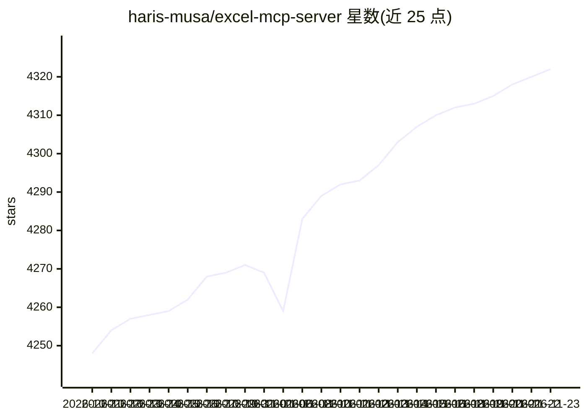

# haris-musa/excel-mcp-server

⭐ 4,322 · Python · MIT · 推送 2026-11-20 · [GitHub](https://github.com/haris-musa/excel-mcp-server) · [官网](https://excelmcpserver.com) · 个人维护

**让 Claude/Cursor 等 AI 客户端读写编辑 Excel 文件的 MCP 服务器**

基于 openpyxl 的 Model Context Protocol 服务器，供 Claude Desktop、Cursor、VS Code Copilot、Codex、Gemini CLI 等 AI 客户端通过工具调用来创建、读取和编辑 Excel 文件，无需安装 Microsoft Excel。内置公式计算引擎（479 个函数）使读取未打开过的文件也能返回数值；支持图表、数据透视表、切片器、条件格式、宏读取（写 VBA 需 --allow-vba-write 开关）、大文件流式分页读取，并提供 --allow-dir 文件夹限制、只读模式与仅本机监听等安全配置。

## 筛选速览

| 维度 | 判定 | 备注 |
|---|---|---|
| AI 角色 | `ai-ecosystem` | LLM/agent 周边工具 |
| 许可风险 | `permissive` | MIT |
| 部署形态 | `self-host` | docker 或自建部署 |
| 模型依赖 | — | README 未给出锁定关系 |
| 硬件要求 | — | 无带数字的原话,不猜 |
| 安装摩擦 | `low` | 无编译、无系统依赖或容器化 |
| 成熟度 | — | 结构信号不足 |

## 能力要点

- 通过 MCP 协议向 AI 客户端暴露 Excel 操作工具集（工作簿/单元格/图表/透视表等 8 个区域）
- 内置公式计算引擎（479 函数），无需 Excel 即可计算并返回公式值
- 大文件流式分页读取与按行解析编辑，支持 --max-file-mb/--max-cells 等上限配置
- 支持 stdio 与 streamable-http 两种运行模式，含 Bearer token 认证与 Docker 部署

## 适用场景

- 让 Claude Desktop 对话式创建带图表和透视表的 Excel 报表
- 在 Cursor/Codex 等 IDE 中直接读写项目内的 xlsx 数据文件
- 通过 HTTP 远程部署给团队共享的 Excel 处理服务
- 批量导入导出 CSV 并保留 Excel 式的类型推断

## 场景标签

`数据分析` · 领域:效率与自动化

## 证据(README 行号)

> L13: An open-source Model Context Protocol (MCP) server that lets
> L15: charts, PivotTables, formulas, tables and more. It is built on `openpyxl`, needs **no Microsoft

## 星数曲线

2026-10-21 4,248 → 2026-11-23 4,322（+74）

---
*卡片 v1 · prompt 1.4 · 生成 2026-11-22 · 置信度 high · 依据 README sha `8848fa88ebc1` · [字段定义](../../DATASET.md)*
