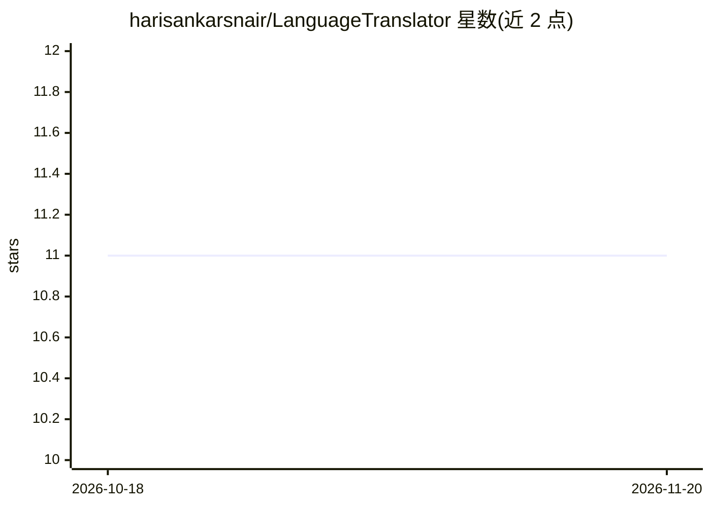

# harisankarsnair/LanguageTranslator

⭐ 11 · Python · 推送 2026-02-19 · [GitHub](https://github.com/harisankarsnair/LanguageTranslator) · 个人维护

**网页翻译应用：多语言互译并生成可下载的语音**

基于 Streamlit 的网页翻译应用，调用 Google Translate 接口在绝大多数世界语言之间进行文本翻译，并使用 gTTS（Google 文本转语音）将翻译结果生成音频文件供用户下载。README 说明依赖 Streamlit、googletrans、gTTS 三个库，提供 Streamlit Sharing 托管的在线演示地址，未包含本地安装或部署步骤的具体命令。

## 筛选速览

| 维度 | 判定 | 备注 |
|---|---|---|
| AI 角色 | `ai-native` | 本体是模型或模型工具 |
| 许可风险 | `none` | — |
| 部署形态 | `None` |  |
| 模型依赖 | — | README 未给出锁定关系 |
| 硬件要求 | — | 无带数字的原话,不猜 |
| 安装摩擦 | `low` | 无编译、无系统依赖或容器化 |
| 成熟度 | — | 结构信号不足 |

## 能力要点

- 支持绝大多数世界语言的文本互译
- 调用 gTTS 将翻译结果生成音频文件
- 支持音频文件下载
- 提供 Streamlit Sharing 在线演示地址

## 适用场景

- 在网页上快速翻译一段文本到目标语言
- 需要把翻译结果转成语音并下载
- 演示 Streamlit 应用构建流程的参考项目

## 场景标签

`语音合成` · 领域:内容生成

## 证据(README 行号)

> L6:  * Translates to any language
> L13: * googletrans - google translate api

## 星数曲线

2026-10-18 11 → 2026-11-20 11（+0）

---
*卡片 v1 · prompt 1.4 · 生成 2026-11-18 · 置信度 high · 依据 README sha `965285ea1878` · [字段定义](../../DATASET.md)*
