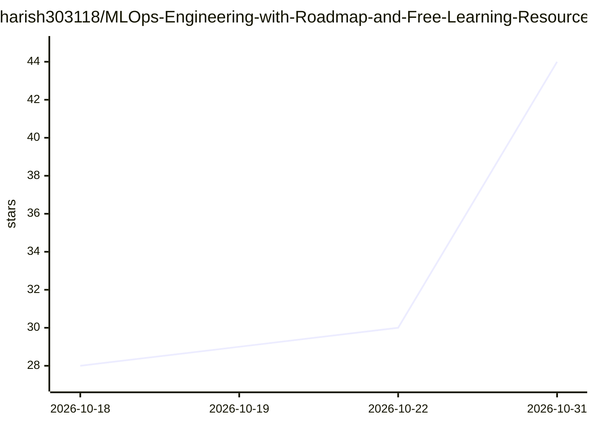

# harish303118/MLOps-Engineering-with-Roadmap-and-Free-Learning-Resources

⭐ 44 · 推送 2026-01-02 · [GitHub](https://github.com/harish303118/MLOps-Engineering-with-Roadmap-and-Free-Learning-Resources) · [官网](https://codersnote.com/) · 个人维护

**MLOps 工程师学习路线与免费教程资源清单**

面向 MLOps 学习者的策展型知识库：按 6 个阶段组织免费视频教程与官方文档链接，覆盖 Python/ML 基础、数据工程与特征工程、MLflow/Kubeflow/Airflow/DVC 等框架工具、Docker/Kubernetes/CI-CD/云平台、模型部署与监控，以及安全伦理、联邦学习等进阶主题。仓库本身不含代码或工具，仅提供资源链接与学习路径指引，并附交互式路线图与 AI 辅导站链接。

## 筛选速览

| 维度 | 判定 | 备注 |
|---|---|---|
| AI 角色 | `ai-knowledge` | 知识聚合/清单类 |
| 许可风险 | `none` | — |
| 部署形态 | `None` |  |
| 模型依赖 | — | README 未给出锁定关系 |
| 硬件要求 | — | 无带数字的原话,不猜 |
| 安装摩擦 | `low` | 无编译、无系统依赖或容器化 |
| 成熟度 | — | 结构信号不足 |

## 能力要点

- 6 阶段路线：基础→核心技能→框架→基础设施→生产优化→进阶专题
- 各主题均提供免费视频教程与官方文档链接
- 覆盖 MLflow、Kubeflow、Airflow、DVC、Docker、Kubernetes 等主流 MLOps 工具的学习资源

## 适用场景

- 按阶段自学成为 MLOps 工程师
- 为各 MLOps 工具查找免费视频与官方文档入口
- 规划从 ML 基础到生产部署的学习路径

## 场景标签

`精选清单` `教程课程` · 领域:学习与行业

## 证据(README 行号)

> L9: > **The ultimate MLOps Engineer Roadmap 2026.**
> L18: ## Phase 1: Foundations

## 星数曲线

2026-10-18 28 → 2026-10-31 44（+16）

---
*卡片 v1 · prompt 1.4 · 生成 2026-10-26 · 置信度 high · 依据 README sha `0e61b6b6818d` · [字段定义](../../DATASET.md)*
