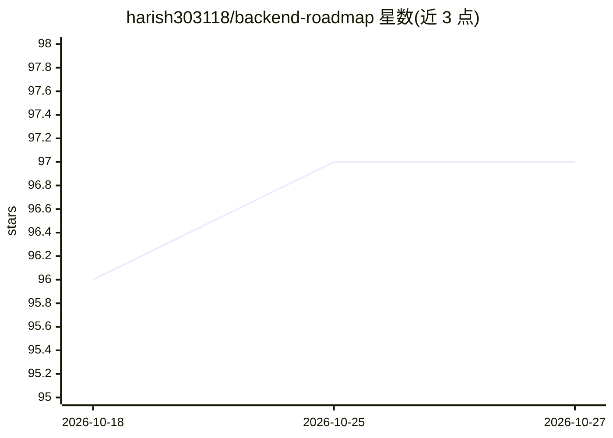

# harish303118/backend-roadmap

⭐ 97 · Apache-2.0 · 推送 2025-12-10 · [GitHub](https://github.com/harish303118/backend-roadmap) · [官网](https://codersnote.com) · 个人维护

**后端开发学习路线清单：免费视频与文档资源分阶段聚合**

面向后端开发学习者的资源聚合清单，按 7 个阶段组织：编程语言（JS/Python/Java/Go/C#/PHP/Ruby）、核心后端技能（REST API、认证、缓存、测试）、后端框架（Express/Django/Spring Boot 等 13 个）、SQL 与 NoSQL 数据库、DevOps（Docker、云平台、CI/CD）、生产部署与扩展、微服务/消息队列/WebSockets/GraphQL 等进阶主题。每项主题附免费视频课程与官方文档链接，另引导外部 AI Tutor Lyra 生成个性化学习路线。仓库本身为 Markdown 清单，无安装或运行要求。

## 筛选速览

| 维度 | 判定 | 备注 |
|---|---|---|
| AI 角色 | `ai-knowledge` | 知识聚合/清单类 |
| 许可风险 | `permissive` | Apache-2.0 |
| 部署形态 | `None` |  |
| 模型依赖 | — | README 未给出锁定关系 |
| 硬件要求 | — | 无带数字的原话,不猜 |
| 安装摩擦 | `medium` | 含编译或系统依赖之一 |
| 成熟度 | — | 结构信号不足 |

## 能力要点

- 7 阶段后端学习路线，覆盖语言/框架/数据库/DevOps/系统设计
- 每主题配套免费视频课程与官方文档链接
- 13 个后端框架条目按语言归类
- 引导外部 AI Tutor Lyra 生成个性化路线与课程

## 适用场景

- 按阶段自学后端开发，查找免费课程与文档
- 对比不同语言对应的后端框架再选定学习方向
- 准备后端面试前补充系统设计与安全知识

## 场景标签

`精选清单` · 领域:学习与行业

## 证据(README 行号)

> L9: > **The ultimate Backend Developer Roadmap 2025.** You don't need expensive courses. This repository collects the be
> L15: （目录 7 行略）

## 星数曲线

2026-10-18 96 → 2026-10-27 97（+1）

---
*卡片 v1 · prompt 1.4 · 生成 2026-10-24 · 置信度 high · 依据 README sha `d457cc406eaa` · [字段定义](../../DATASET.md)*
