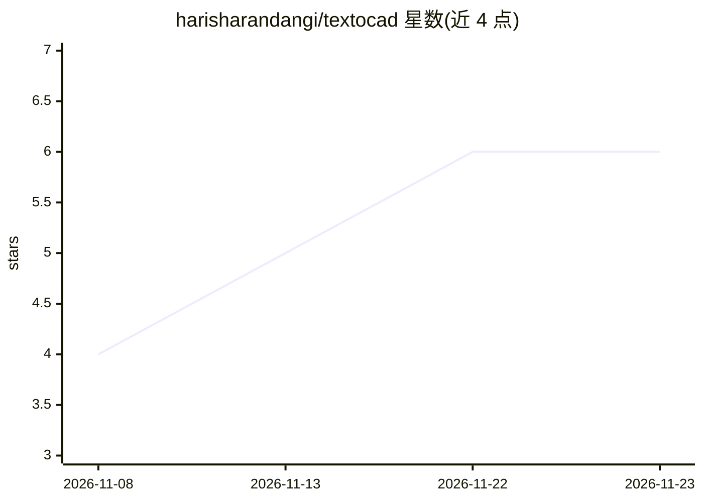

# harisharandangi/textocad

⭐ 6 · Python · NOASSERTION · 推送 2026-11-02 · [GitHub](https://github.com/harisharandangi/textocad) · [官网](https://textocad.com) · 个人维护

**给工程师/创客：英文描述生成可编辑参数化 CAD 模型**

本地运行的 text-to-CAD 引擎：输入英文描述，由 LLM 生成带命名尺寸参数的 CadQuery 或 OpenSCAD build(params) 脚本，在沙箱进程中构建并导出 STEP/STL/GLB/3MF（机器人模式另出 URDF）。提供四种模式（printing/precision/organic/robotics）、本地 Web 应用（聊天改型、3D 查看、尺寸滑块无 AI 调用重建）与 HTTP API、Python API。--details 可抽取可测量需求并自检重建。限制：Python 仅支持 3.11/3.12，printing 模式需另装 OpenSCAD，使用自有 LLM API key，许可为 PolyForm Noncommercial。

## 筛选速览

| 维度 | 判定 | 备注 |
|---|---|---|
| AI 角色 | `ai-native` | 本体是模型或模型工具 |
| 许可风险 | `none` | NOASSERTION |
| 部署形态 | `library` | 以包/库形式分发 |
| 模型依赖 | locked-api |  |
| 硬件要求 | — | 无带数字的原话,不猜 |
| 安装摩擦 | `low` | 无编译、无系统依赖或容器化 |
| 成熟度 | — | 结构信号不足 |

## 能力要点

- 生成带命名参数的 CadQuery/OpenSCAD 脚本，改尺寸无需新 AI 调用
- 四种模式：OpenSCAD+BOSL2 打印件、OpenCASCADE B-rep、SDF 有机形体、关节机器人装配
- --details 自检：测量构件是否满足孔数/齿数/尺寸需求，不符则重生成
- 沙箱构建进程带 import 白名单与内存/CPU 限制

## 适用场景

- 为 3D 打印生成参数化外壳与支架
- 机械设计中生成可导入 CAD 工具的 STEP 实体
- 机器人臂建模并导出 URDF/ROS 2 包
- 通过对话式聊天逐步修改零件尺寸

## 场景标签

`代码生成` · 领域:编码与开发

## 证据(README 行号)

> L22: AI image and mesh generators give you a blob you can't edit. TextoCAD writes **real CAD code** instead, so you get 
> L187: prompt ──► mode router ──► LLM writes a build(params) script ──► sandboxed build ──► STEP / STL / GLB / 3MF
> L193: 2. **Write.** The model writes a CadQuery or OpenSCAD script with a parameter list (name, value, min, max, unit).

## 星数曲线

2026-11-08 4 → 2026-11-23 6（+2）

---
*卡片 v1 · prompt 1.4 · 生成 2026-11-21 · 置信度 high · 依据 README sha `98699c1154d5` · [字段定义](../../DATASET.md)*
