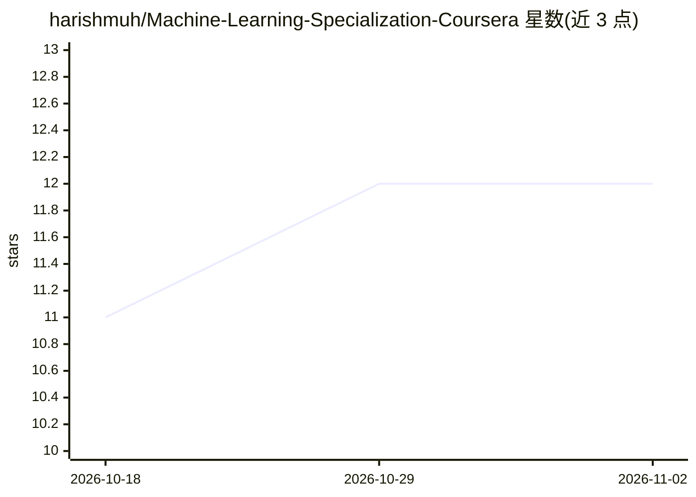

# harishmuh/Machine-Learning-Specialization-Coursera

⭐ 12 · Jupyter Notebook · MIT · 推送 2026-04-22 · [GitHub](https://github.com/harishmuh/Machine-Learning-Specialization-Coursera) · 个人维护

**吴恩达机器学习专项课程的实验与作业解答整理仓库**

收录斯坦福大学与 DeepLearning.AI 联合推出的 Machine Learning Specialization（Coursera，吴恩达主讲）三门课程的 Jupyter 实验笔记与编程作业参考解答：课程 1 覆盖线性回归、逻辑回归与正则化，课程 2 覆盖神经网络、TensorFlow 训练与决策树，课程 3 覆盖异常检测、K-means、推荐系统与强化学习。README 以周次结构逐条列出文件名，无安装命令或运行说明。作者声明文件仅供参考，供卡在作业时查阅。

## 筛选速览

| 维度 | 判定 | 备注 |
|---|---|---|
| AI 角色 | `ai-knowledge` | 知识聚合/清单类 |
| 许可风险 | `permissive` | MIT |
| 部署形态 | `None` |  |
| 模型依赖 | — | README 未给出锁定关系 |
| 硬件要求 | — | 无带数字的原话,不猜 |
| 安装摩擦 | `low` | 无编译、无系统依赖或容器化 |
| 成熟度 | — | 结构信号不足 |

## 能力要点

- 按课程/周次结构化列出实验与作业文件清单
- 覆盖三门课程：监督学习、高级学习算法、无监督/推荐/强化学习
- 包含 Scikit-Learn 与 TensorFlow 实践实验条目

## 适用场景

- 学习课程时对照参考解答排查作业卡点
- 查找各周实验的文件索引与主题覆盖
- 复习线性回归到强化学习的课程知识点结构

## 场景标签

`教程课程` · 领域:学习与行业

## 证据(README 行号)

> L5: This repository contains curated resources, notebooks, and exercise solutions for the Machine Learning Specializatio
> L88: I know some people are struggling to finish the course (including myself) as it takes time to understand new concep

## 星数曲线

2026-10-18 11 → 2026-11-02 12（+1）

---
*卡片 v1 · prompt 1.4 · 生成 2026-11-01 · 置信度 high · 依据 README sha `ad58671c8796` · [字段定义](../../DATASET.md)*
