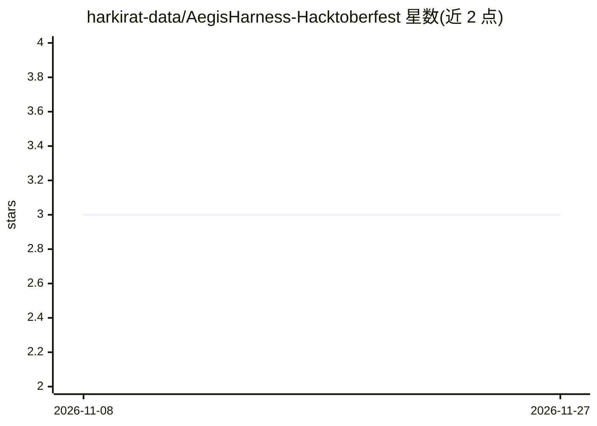

# harkirat-data/AegisHarness-Hacktoberfest

⭐ 3 · HTML · 推送 2026-10-31 · [GitHub](https://github.com/harkirat-data/AegisHarness-Hacktoberfest) · 个人维护

**面向 AI agent 的三区隔离红队安全评估沙箱**

AegisHarness 将红队攻击工具链、目标 LLM 工作负载与蓝队带外审计拆分为三个互不重叠的零信任隔离区，用于对自主 agent 做对抗鲁棒性测试与运行时遏制。内置 4 个受控工具（文件读取、Python AST 评估、命令白名单执行、默认拒绝出站 HTTP），配合 SHA-256 哈希链 WORM 审计账本与自动隔离状态机（SLA <50ms）。依赖本地 Ollama 运行 qwen2.5:3b Q4_K_M 模型，在 4 GB VRAM 的消费级 GPU 上验证；README 提供 8 项对抗场景的验证结果。

## 筛选速览

| 维度 | 判定 | 备注 |
|---|---|---|
| AI 角色 | `ai-ecosystem` | LLM/agent 周边工具 |
| 许可风险 | `none` | — |
| 部署形态 | `self-host` | docker 或自建部署 |
| 模型依赖 | local-ok | 支持本地模型 |
| 硬件要求 | `gpu-8g` | |
| 安装摩擦 | `low` | 无编译、无系统依赖或容器化 |
| 成熟度 | — | 结构信号不足 |

## 能力要点

- 红/靶/蓝三区物理与逻辑隔离的零信任架构
- 默认拒绝出站防火墙，阻止 IMDS、回环与私有网段
- SHA-256 哈希链 WORM 审计账本，可检测篡改/降级/删改
- 8 项对抗评估场景（路径穿越、越权读取、SSRF 等）的验证套件

## 适用场景

- 对带工具调用能力的 agent 做红队对抗测试
- 验证 agent 运行时的越权文件/网络访问遏制
- 为 agent 安全事件留存防篡改审计记录

## 场景标签

`网络安全` `模型评测` · 领域:评测与运维

## 证据(README 行号)

> L3: AegisHarness is an infrastructure-layer, multi-tenant evaluation sandbox engineered for adversarial robustness testi
> L60: * **Execution Boundary:** The local Ollama daemon runs as an accelerated local service, while the Agent Controller 
> L71: AegisHarness provides a modular, schema-validated Autonomous Agent Controller and a Controlled Tool Registry implem

## 星数曲线

2026-11-08 3 → 2026-11-27 3（+0）

---
*卡片 v1 · prompt 1.4 · 生成 2026-11-21 · 置信度 high · 依据 README sha `6679b9947a7d` · [字段定义](../../DATASET.md)*
