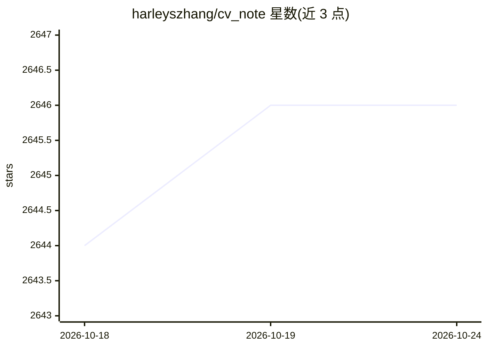

# harleyszhang/cv_note

⭐ 2,646 · Python · Apache-2.0 · 推送 2026-05-10 · [GitHub](https://github.com/harleyszhang/cv_note) · 个人维护 · 中文 README

**CV 算法工程师成长之路的个人技术笔记与面经汇总（逐步废弃）**

个人维护的计算机视觉算法工程师技术笔记仓库，内容涵盖深度学习与 Python 基础、CV 算法工程师学习路线、面试题汇总与可投递公司表格（侧重 CV 算法与算法优化/部署岗位）。README 同时推广作者的付费大模型推理框架课程（499 元，基于 Triton + PyTorch 从 0 到 1 实现推理框架，支持 FlashAttention/PageAttention，适配 llama/qwen2.5/llava1.5）。作者声明本项目正逐步废弃，内容不再更新，推荐移步 dl_note 和 lite_llama 仓库。

## 筛选速览

| 维度 | 判定 | 备注 |
|---|---|---|
| AI 角色 | `ai-knowledge` | 知识聚合/清单类 |
| 许可风险 | `permissive` | Apache-2.0 |
| 部署形态 | `None` |  |
| 模型依赖 | — | README 未给出锁定关系 |
| 硬件要求 | — | 无带数字的原话,不猜 |
| 安装摩擦 | `medium` | 含编译或系统依赖之一 |
| 成熟度 | — | 结构信号不足 |

## 能力要点

- CV 算法工程师学习路线与深度学习/Python 基础笔记
- 大厂面试题分类总结与可投递公司汇总表
- 附带付费大模型推理框架课程（Triton + PyTorch，支持 FlashAttention V1-V3/PageAttention/GQA，适配 llama/qwen2.5/llava1.5）

## 适用场景

- 查找 CV 算法工程师的学习路线和基础知识笔记
- 了解 CV/部署岗位可投递公司与面经
- 了解作者的大模型推理框架付费课程内容

## 场景标签

`教程课程` · 领域:学习与行业

## 证据(README 行号)

> L55: > 本项目最初是当作 cv 算法工程师实习内推表、校招可投递公司汇总以及个人面经的汇总，后面逐步转变为个人 cv 算法工程师成长之路所记录的技术栈笔记、以及少部分面经等内容。
> L59: 本项目正逐步废弃，大部分内容不再更新，关于深度学习、大模型推理以及大模型推理框架开发的知识，欢迎移步 dl_note、和 lite_llama 仓库阅读。

## 星数曲线

2026-10-18 2,644 → 2026-10-24 2,646（+2）

---
*卡片 v1 · prompt 1.4 · 生成 2026-10-21 · 置信度 high · 依据 README sha `c404fa0b64d9` · [字段定义](../../DATASET.md)*
