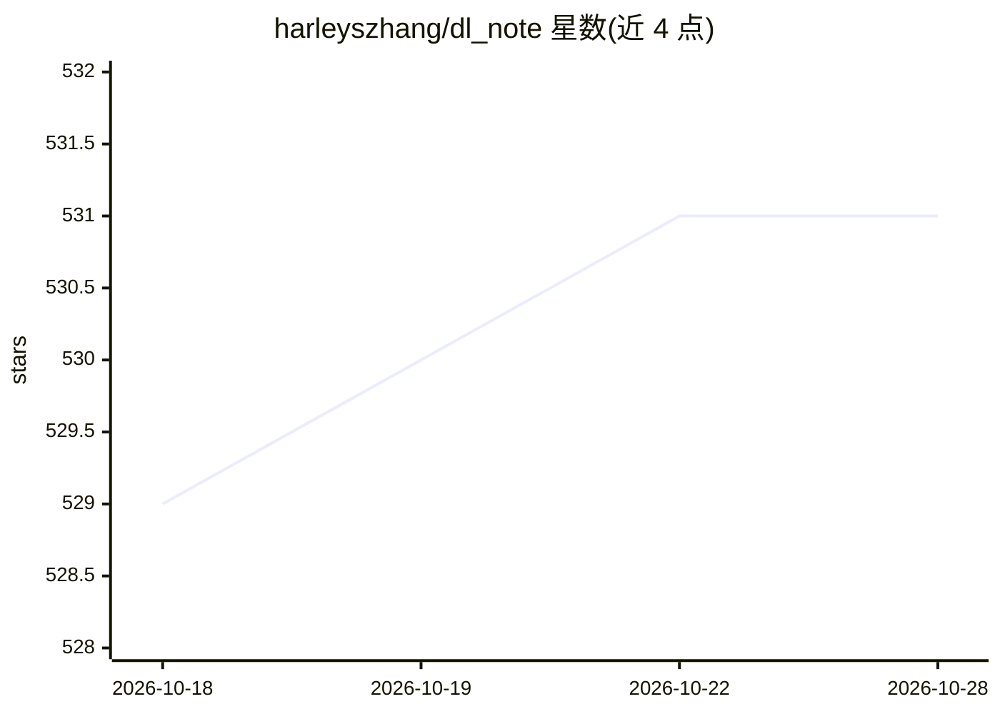

# harleyszhang/dl_note

⭐ 531 · Python · Apache-2.0 · 推送 2026-08-31 · [GitHub](https://github.com/harleyszhang/dl_note) · 个人维护 · 中文 README

**个人深度学习系统学习笔记库：数学基础到模型压缩、推理部署**

个人维护的计算机视觉与大语言模型学习笔记仓库，按专栏组织：数学与编程基础、神经网络基础部件（卷积/BN/激活函数）、经典 CNN backbone 与轻量级网络、炼丹策略、模型压缩（剪枝/蒸馏/量化）、推理部署与 ncnn 源码解析、NEON/CUDA 异构计算，并附外部教程与书籍参考资料。仓库同时推广付费自制大模型推理框架课程（499 元，基于 Triton+PyTorch）。本仓库本体为 Markdown 笔记，无安装运行流程。

## 筛选速览

| 维度 | 判定 | 备注 |
|---|---|---|
| AI 角色 | `ai-knowledge` | 知识聚合/清单类 |
| 许可风险 | `permissive` | Apache-2.0 |
| 部署形态 | `None` |  |
| 模型依赖 | — | README 未给出锁定关系 |
| 硬件要求 | — | 无带数字的原话,不猜 |
| 安装摩擦 | `medium` | 含编译或系统依赖之一 |
| 成熟度 | — | 结构信号不足 |

## 能力要点

- 覆盖数学基础、网络部件、炼丹、模型压缩、推理部署的成体系笔记目录
- ncnn 推理框架源码解析与 NEON/CUDA 异构计算编程笔记
- 附带付费自制大模型推理框架课程（Triton+PyTorch）介绍
- LLM 基础及推理优化内容另存放于 llm_note 仓库

## 适用场景

- 系统学习深度学习基础与模型压缩算法
- 查阅 CNN backbone 与轻量化网络设计笔记
- 了解推理部署与 ncnn 源码、异构计算编程

## 场景标签

`教程课程` · 领域:学习与行业

## 证据(README 行号)

> L5: 本仓库项目是个人总结的计算机视觉和大语言模型学习笔记，包含深度学习基础知识、神经网络基础部件详解、深度学习炼丹策略、深度学习模型压缩算法、深度学习推理框架代码解析及动手实战。
> L48: ## 一，数学和编程基础专栏

## 星数曲线

2026-10-18 529 → 2026-10-28 531（+2）

---
*卡片 v1 · prompt 1.4 · 生成 2026-10-21 · 置信度 high · 依据 README sha `b99e98e4c3e7` · [字段定义](../../DATASET.md)*
