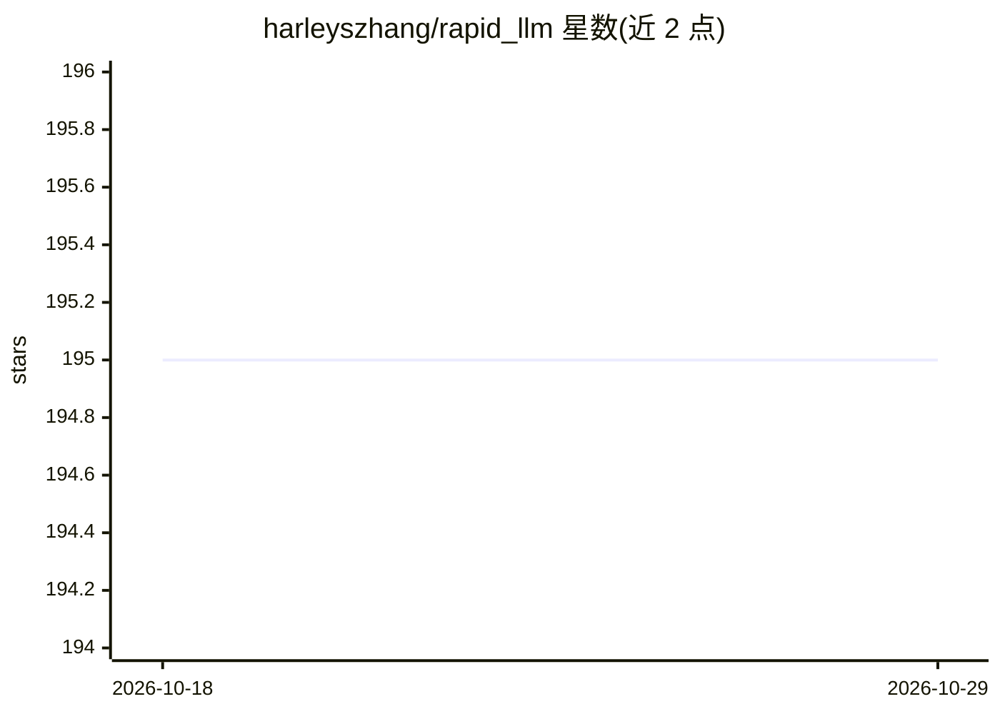

# harleyszhang/rapid_llm

⭐ 195 · Python · 推送 2026-10-10 · [GitHub](https://github.com/harleyszhang/rapid_llm) · 组织维护 · 中文 README

**LLM 推理框架：连续批处理、张量/数据并行与量化**

RapidLLM 是一个 Python LLM 推理框架，提供连续批处理、张量/数据并行、专家并行、CUDA Graph、Chunked Prefill、前缀缓存与多种量化（W4A16/W8A16/W8A8/FP8 KV Cache 等），内核后端可插拔（Triton/CUDA，flashinfer 可选）。模型注册表含 LLaMA、Qwen2/3、Qwen3-MoE、Qwen3-VL、LLaVA、DeepSeek 系列，但注册不代表每种权重/量化/设备组合均已验证。提供 Python API、连续批处理调度器与 OpenAI 兼容 HTTP 服务（含 SSE 流式与 /metrics）。支持 CPU（Gloo）、Linux 与 macOS（无 Triton），需 Python 3.13+，从仓库源码安装。

## 筛选速览

| 维度 | 判定 | 备注 |
|---|---|---|
| AI 角色 | `ai-ecosystem` | LLM/agent 周边工具 |
| 许可风险 | `none` | — |
| 部署形态 | `library` | 以包/库形式分发 |
| 模型依赖 | — | README 未给出锁定关系 |
| 硬件要求 | — | 无带数字的原话,不猜 |
| 安装摩擦 | `medium` | 含编译或系统依赖之一 |
| 成熟度 | — | 结构信号不足 |

## 能力要点

- 连续批处理调度：Chunked Prefill、前缀复用、可选抢占重算
- TP/DP/EP 并行与 DP Attention、通信-计算重叠、N-gram 投机解码
- 多档量化：INT8/FP8/INT4/AWQ/GPTQ/SmoothQuant/NVFP4/FP8 KV Cache
- OpenAI 兼容服务：/v1/completions、/v1/chat/completions、SSE、/metrics

## 适用场景

- 在本机或集群上部署 LLaMA/Qwen/DeepSeek 系列模型做推理服务
- 通过 OpenAI 兼容 API 对外提供补全与对话端点
- 在无 GPU 的 Linux/macOS 上用 CPU 模式运行小模型

## 场景标签

`推理引擎` · 领域:训练与推理

## 证据(README 行号)

> L28: RapidLLM is an LLM inference framework with continuous batching, tensor and data parallelism, quantized weights, an
> L118: .venv/bin/rapid-llm serve --model-dir my_weight/Qwen2.5-0.5B \

## 星数曲线

2026-10-18 195 → 2026-10-29 195（+0）

---
*卡片 v1 · prompt 1.4 · 生成 2026-10-23 · 置信度 mid · 依据 README sha `2e3ed23689d3` · [字段定义](../../DATASET.md)*
