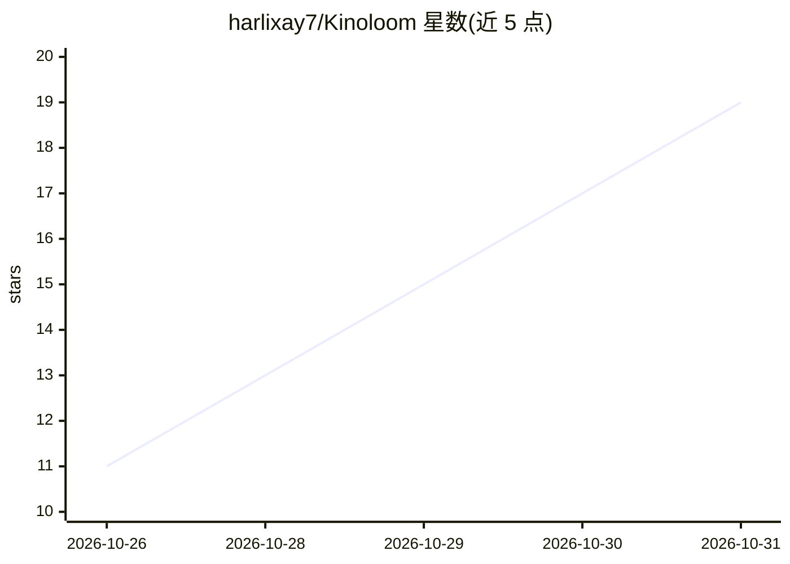

# harlixay7/Kinoloom

⭐ 19 · Python · MIT · 推送 2026-10-29 · [GitHub](https://github.com/harlixay7/Kinoloom) · 个人维护

**单卡 8GB Windows PC 上的本地 AI 电影工作室，生成短片并无缝接长镜头**

基于 ComfyUI 构建的本地 AI 影片制作 Web 应用：LLM 协作写故事并维护角色/场景设定集，图像模型生成演员肖像与起始帧，视频模型（LTX-2.5、MiniMax H3、Qwen-Image 2.1）渲染镜头，seamless-chain 引擎在潜空间内把多段短片段连成一个长镜头，QA 步骤检查运动与人脸一致性后自动剪辑。通过 8GB 显存 + 64GB 内存的单机流式加载运行 20B+ 参数模型。MiniMax H3 与 RealVisXL 权重需自备，项目声明仅在一台机器（RTX 3070）上测试过。

## 筛选速览

| 维度 | 判定 | 备注 |
|---|---|---|
| AI 角色 | `ai-native` | 本体是模型或模型工具 |
| 许可风险 | `permissive` | MIT |
| 部署形态 | `desktop` | 安装包/桌面程序 |
| 模型依赖 | local-ok | 支持本地模型 |
| 硬件要求 | — | 无带数字的原话,不猜 |
| 安装摩擦 | `medium` | 含编译或系统依赖之一 |
| 成熟度 | `idea` | |

## 能力要点

- seamless-chain 引擎在潜空间内把多段短片接成一个长镜头（避免接缝跳变）
- 在 8GB 显存单机上流式运行 20B+ 参数视频模型（LTX-2.5 / MiniMax H3）
- LLM 写故事 + 'bible' 维持角色与场景一致性 + QA 检查运动与人脸
- INSTALL.bat 一键搭建 ComfyUI 树、环境并下载所选模型权重（H3/RealVisXL 除外）

## 适用场景

- 在单张 8GB 显卡 PC 上制作带连续长镜头的 AI 短片
- 保持同一批角色外观在多个镜头间一致
- 本地生成演员肖像、起始帧并渲染成片，无需云端服务

## 场景标签

`视频生成` `图像生成` · 领域:内容生成

## 证据(README 行号)

> L3: **A local AI film studio for one Windows PC with an 8 GB NVIDIA graphics card and 64 GB of RAM.**
> L25: - an LLM writes the story with you, and a "bible" keeps characters and places consistent;
> L27: - video models render the shots, and longer takes are joined in latent space instead of cut together;

## 星数曲线

2026-10-26 11 → 2026-10-31 19（+8）

---
*卡片 v1 · prompt 1.4 · 生成 2026-10-30 · 置信度 mid · 依据 README sha `811173900c56` · [字段定义](../../DATASET.md)*
