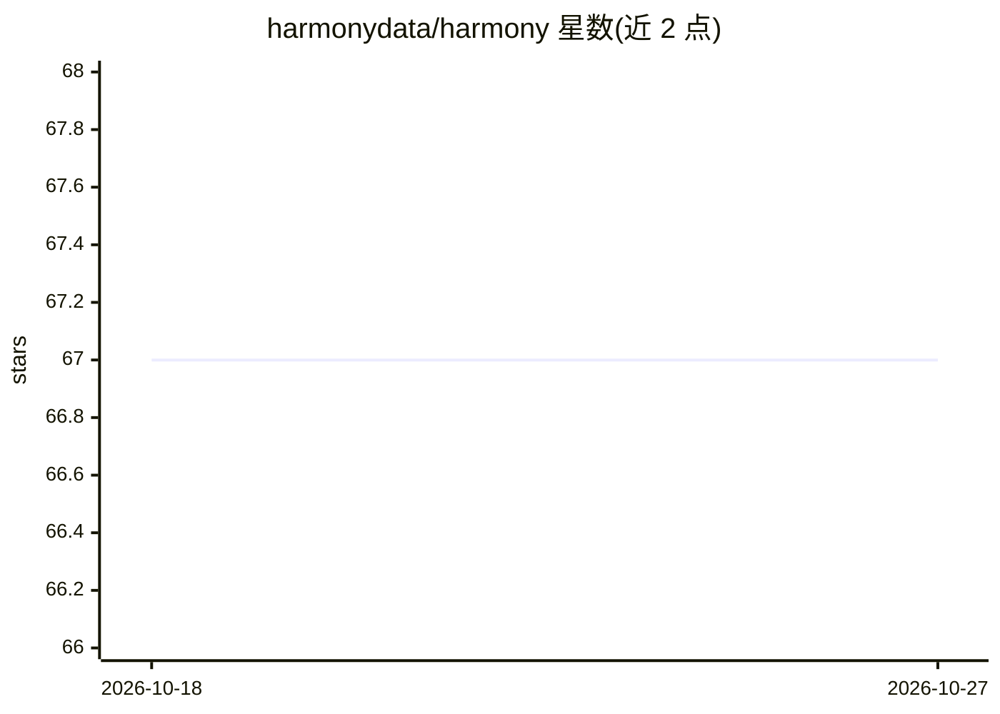

# harmonydata/harmony

⭐ 67 · Python · MIT · 推送 2026-10-23 · [GitHub](https://github.com/harmonydata/harmony) · [官网](https://harmonydata.ac.uk) · 组织维护

**帮助心理学研究者用 NLP 匹配跨语言问卷条目的 Python 库**

Harmony 是面向心理学家与社会科学研究者的工具：从 PDF、Excel、Word 或 Google Forms 中提取问卷条目，用 sentence-transformers 多语言嵌入向量计算条目间相似度矩阵（含极性），实现跨语言问卷的 harmonisation。默认使用 paraphrase-multilingual-MiniLM-L12-v2 模型，可通过环境变量替换 Hugging Face 向量化模型或传入自定义函数（如 OpenAI 嵌入）。以 PyPI 包和 Docker 镜像提供，另有网页版应用；PDF 解析需要 Java 与 Apache Tika。

## 筛选速览

| 维度 | 判定 | 备注 |
|---|---|---|
| AI 角色 | `ai-native` | 本体是模型或模型工具 |
| 许可风险 | `permissive` | MIT |
| 部署形态 | `self-host` | docker 或自建部署 |
| 模型依赖 | — | README 未给出锁定关系 |
| 硬件要求 | — | 无带数字的原话,不猜 |
| 安装摩擦 | `low` | 无编译、无系统依赖或容器化 |
| 成熟度 | — | 结构信号不足 |

## 能力要点

- 从 PDF/Excel/Word/Google Forms 提取问卷条目并计算相似度矩阵（含极性）
- 默认多语言 sentence-transformers 嵌入，支持跨语言条目匹配
- 可替换 Hugging Face 向量化模型或传入自定义向量函数（如 OpenAI）
- 提供 PyPI 包、Docker 镜像、Colab/R notebook 与网页版

## 适用场景

- 匹配不同语言/版本问卷中的相似条目以做数据 harmonisation
- 批量从 PDF 或 Google Forms 问卷中提取条目
- 研究者用 Python/R notebook 快速上手问卷匹配流程

## 场景标签

`语义搜索` `文档解析` `科研工具` · 领域:知识与检索

## 证据(README 行号)

> L26: * Psychologists and social scientists often have to match items in different questionnaires, such as "I often feel 
> L30: * Enter Harmony, a tool that uses natural language processing and generative AI models to help researchers harmonis
> L210: Harmony defaults to `sentence-transformers/paraphrase-multilingual-MiniLM-L12-v2` (HuggingFace link). However you 

## 星数曲线

2026-10-18 67 → 2026-10-27 67（+0）

---
*卡片 v1 · prompt 1.4 · 生成 2026-10-24 · 置信度 high · 依据 README sha `c6e992c4f6bd` · [字段定义](../../DATASET.md)*
