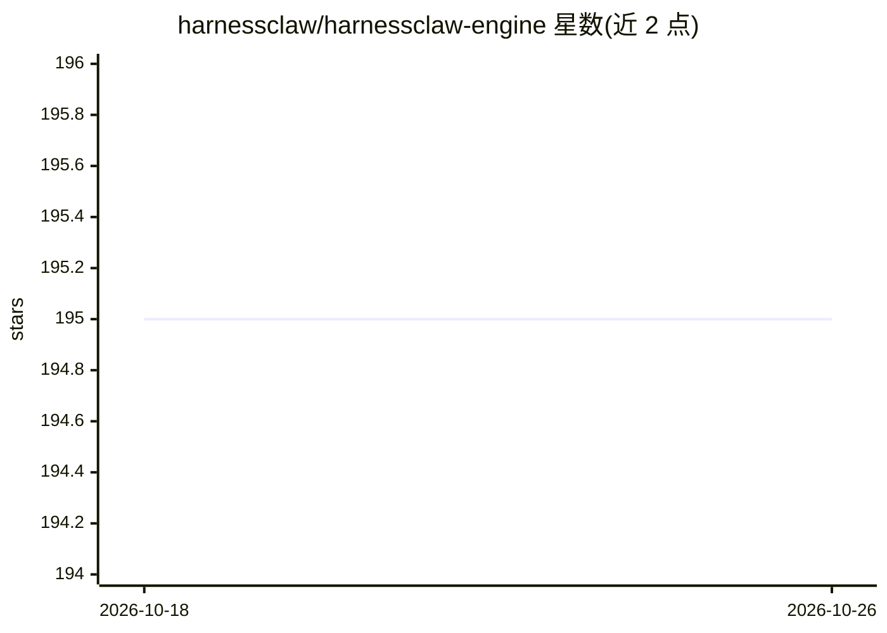

# harnessclaw/harnessclaw-engine

⭐ 195 · Go · Apache-2.0 · 推送 2026-10-21 · [GitHub](https://github.com/harnessclaw/harnessclaw-engine) · 组织维护 · 中文 README

**Go 编写的 LLM 编程助手引擎，提供 WebSocket 服务与工具调用**

用 Go 实现的 LLM 编程助手引擎：通过 WebSocket/HTTP/飞书三种 Channel 接入，内部按 Channel→Router→Engine→Provider/Tool 单向依赖组织。核心机制包括 5 阶段查询循环、UI-first 卡片模型流式协议 v2.2、7 个内置工具（Bash/文件读写/Grep/Glob/WebFetch）、6 步权限管线（6 种权限模式）、SKILL.md 技能加载，以及多 Provider 支持（Anthropic SSE 直连 + Bifrost 适配 Anthropic/OpenAI/Bedrock/Vertex）。上下文超阈值时自动做 LLM 摘要压缩并带熔断。需 Go 1.26+ 从源码 make build 构建，配置文件为 YAML。

## 筛选速览

| 维度 | 判定 | 备注 |
|---|---|---|
| AI 角色 | `ai-ecosystem` | LLM/agent 周边工具 |
| 许可风险 | `permissive` | Apache-2.0 |
| 部署形态 | `None` |  |
| 模型依赖 | locked-api |  |
| 硬件要求 | — | 无带数字的原话,不猜 |
| 安装摩擦 | `low` | 无编译、无系统依赖或容器化 |
| 成熟度 | — | 结构信号不足 |

## 能力要点

- WebSocket 卡片模型流式协议 v2.2（8 动作 × 13 卡片类型）
- 7 个内置工具与 6 步权限管线、6 种权限模式
- SKILL.md 技能系统（YAML frontmatter、参数替换、优先级覆盖）
- 多 Provider：Anthropic SSE 直连 + Bifrost 适配（OpenAI/Bedrock/Vertex）

## 适用场景

- 为编程助手类产品提供后端引擎，通过 WebSocket 接入自定义客户端
- 构建带权限控制与工具调用的多轮对话 Agent 服务
- 通过 SKILL.md 扩展 Agent 技能并接入飞书渠道

## 场景标签

`编码 Agent` `Agent 框架` · 领域:Agent 开发

## 证据(README 行号)

> L7: An LLM programming assistant engine built with Go. It provides capabilities via the WebSocket protocol, supporting m
> L27: - **Multi-Provider Support** — Direct Anthropic SSE client + Bifrost Multi-Provider adapter (Anthropic/OpenAI/Bedro

## 星数曲线

2026-10-18 195 → 2026-10-26 195（+0）

---
*卡片 v1 · prompt 1.4 · 生成 2026-10-22 · 置信度 high · 依据 README sha `6a96c1572198` · [字段定义](../../DATASET.md)*
