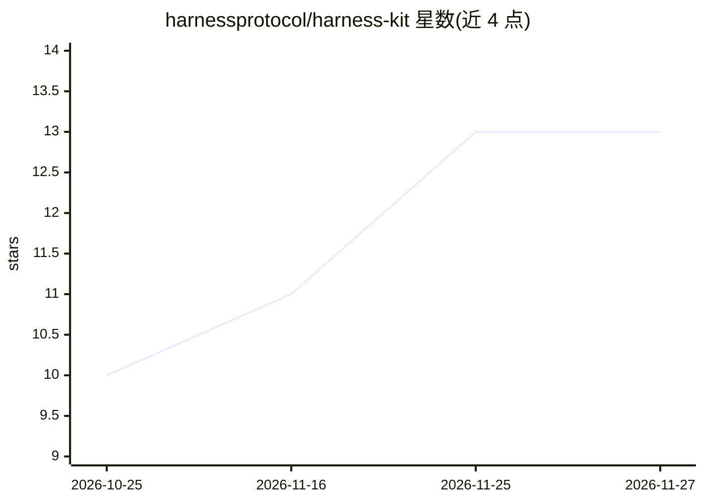

# harnessprotocol/harness-kit

⭐ 13 · TypeScript · Apache-2.0 · 推送 2026-11-26 · [GitHub](https://github.com/harnessprotocol/harness-kit) · [官网](https://harnesskit.ai) · 组织维护

**AI 编码工具配置的打包与同步工具：一份配置应用到多端**

将 AI 编码工具的插件、技能、MCP 服务器、hooks、约定打包为单一 harness.yaml 配置，支持捕获现有配置、按目标工具编译为原生格式、在 8 个支持目标间同步，并提供漂移检测的 CI 检查。分发形态包括 Claude Code 插件市场、brew 安装的 CLI 与 npm 包，以及读取本地文件的 Tauri 桌面应用。默认本地运行不上传源码，组织级工作流处于 release preview 阶段。

## 筛选速览

| 维度 | 判定 | 备注 |
|---|---|---|
| AI 角色 | `ai-ecosystem` | LLM/agent 周边工具 |
| 许可风险 | `permissive` | Apache-2.0 |
| 部署形态 | `desktop` | 安装包/桌面程序 |
| 模型依赖 | — | README 未给出锁定关系 |
| 硬件要求 | — | 无带数字的原话,不猜 |
| 安装摩擦 | `low` | 无编译、无系统依赖或容器化 |
| 成熟度 | — | 结构信号不足 |

## 能力要点

- 一份 harness.yaml 编译到 8 个支持工具的原生配置
- capture/reconcile/apply/rollback 的配置迁移流程与漂移检测 CI
- 17 个插件包括 explain、research、review、lineage、rubber-ducky
- Tauri 桌面应用跨工具查看、复制配置并支持 Comparator 对照运行

## 适用场景

- 团队统一管理各成员的 AI 编码工具配置并检测漂移
- 把现有 Claude Code 配置迁移到 Cursor、Codex 等其他工具
- 在 CI 中拦截编译配置与 harness.yaml 不一致的 PR

## 场景标签

 · 领域:开发者工具/AI 编码工具配置管理

## 证据(README 行号)

> L3: Portable configuration for AI coding tools.
> L16: Your AI coding setup — plugins, skills, MCP servers, hooks, conventions — packaged into a single config you can app
> L103: Capture the native configuration you already use, reconcile it with personal, project, session, and organization p

## 星数曲线

2026-10-25 10 → 2026-11-27 13（+3）

---
*卡片 v1 · prompt 1.4 · 生成 2026-11-18 · 置信度 high · 依据 README sha `e4d4efdf2433` · [字段定义](../../DATASET.md)*
