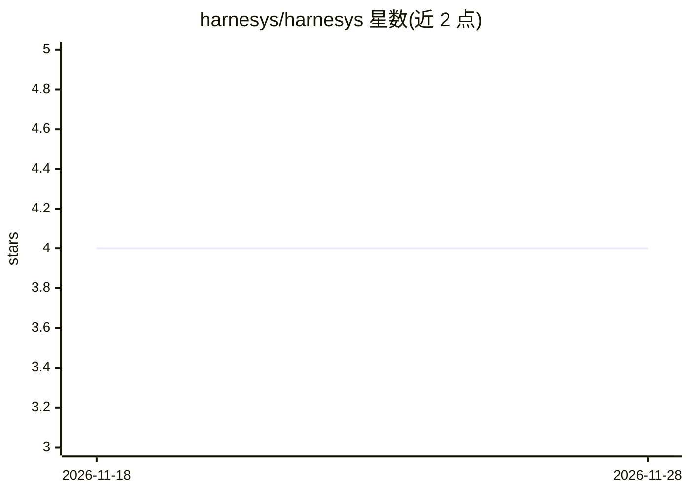

# harnesys/harnesys

⭐ 4 · TypeScript · NOASSERTION · 推送 2026-11-26 · [GitHub](https://github.com/harnesys/harnesys) · [官网](https://harnesys.github.io/harnesys/) · 个人维护

**自托管的多 AI agent 团队控制台：集中监督每次运行**

Harnesys 是面向 AI agent 团队的自托管控制平面：一台主机运行 API 与桌面管理界面（desk），工作机通过邀请码组成 fleet，agent 具备线程、工具、技能、知识、定时任务与审批机制。提供完整运行记录审计（工具调用输入/退出码、每轮 token 计数）、权限门控（allow/ask/deny）、可视化 agent 图编辑器、cron 与 webhook 触发、混合全文+向量检索的持久记忆。数据以 per-org SQLite 存于本地主目录，支持桌面安装包、Docker 与服务器二进制/CLI 三种部署方式。

## 筛选速览

| 维度 | 判定 | 备注 |
|---|---|---|
| AI 角色 | `ai-ecosystem` | LLM/agent 周边工具 |
| 许可风险 | `none` | NOASSERTION |
| 部署形态 | `desktop` | 安装包/桌面程序 |
| 模型依赖 | local-ok | 支持本地模型 |
| 硬件要求 | — | 无带数字的原话,不猜 |
| 安装摩擦 | `low` | 无编译、无系统依赖或容器化 |
| 成熟度 | — | 结构信号不足 |

## 能力要点

- 每次运行的完整审计记录：工具调用输入/退出码、每轮 token 计数、人工审批卡
- 可视化 ReAct 图编辑器，支持 agent 间 spawn/handoff 与步骤/token 预算
- 文件写入、shell、网络、MCP、agent 的 permission gates（allow/ask/deny）
- 内置工作区：Monaco 编辑器（LSP）、git 面板、真实 PTY 终端

## 适用场景

- 在自己机器上运行并监督一组 AI agent 的日常工作
- 对 agent 的文件写入、shell、网络等敏感操作设置审批门控
- 通过 cron/webhook/标签规则让 agent 自动处理看板任务
- 团队内集中审计所有 agent 运行记录与 token 消耗

## 场景标签

`Agent 框架` `多智能体` · 领域:Agent 开发

## 证据(README 行号)

> L16: Harnesys is a self-hosted control plane for teams of AI agents. One host runs the API and the desk UI, worker machi
> L63: 3. **Add a model** — pick a provider from the catalog (OpenAI, Anthropic, Google, OpenRouter, Groq, local Ollama, …

## 星数曲线

2026-11-18 4 → 2026-11-28 4（+0）

---
*卡片 v1 · prompt 1.4 · 生成 2026-11-21 · 置信度 high · 依据 README sha `376a1d7960e0` · [字段定义](../../DATASET.md)*
