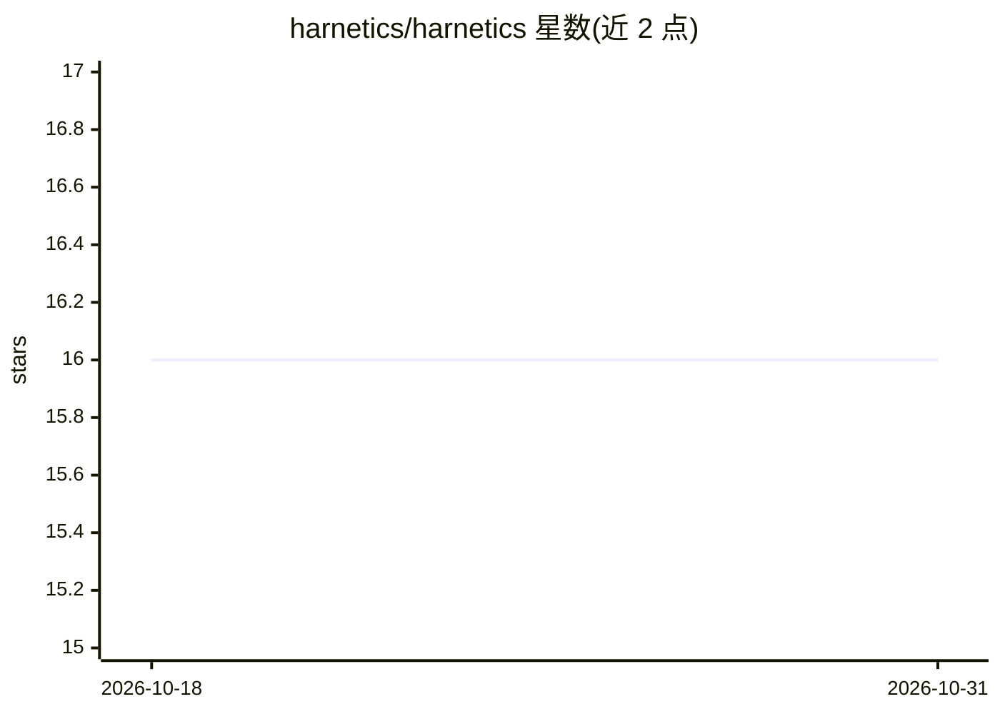

# harnetics/harnetics

⭐ 16 · Python · Apache-2.0 · 推送 2026-06-18 · [GitHub](https://github.com/harnetics/harnetics) · 组织维护 · 中文 README

**给航天工程团队的文档对齐工作台：追溯、草稿生成与变更影响分析**

面向商业航天工程团队的本地优先 Web 工作台，将文档导入、文档图谱构建、LLM 对齐草稿生成、引注与冲突质量门评估（EA/EB/ED）、BFS 变更影响分析串成闭环。支持 Markdown/YAML/DOCX/XLSX/PDF 解析，抽取章节与 ICD 参数并显式存储文档间依赖。后端为 Python 3.12+ FastAPI + SQLite + ChromaDB，前端 React 18。LLM 走 OpenAI-compatible 路由，支持云端或本地 Ollama。提供 Docker 一键启动与源码安装两种方式，桌面安装包通过 Tauri/PyInstaller 构建但正式分发前仍需补充签名与 notarization。

## 筛选速览

| 维度 | 判定 | 备注 |
|---|---|---|
| AI 角色 | `ai-native` | 本体是模型或模型工具 |
| 许可风险 | `permissive` | Apache-2.0 |
| 部署形态 | `self-host` | docker 或自建部署 |
| 模型依赖 | local-ok | 支持本地模型 |
| 硬件要求 | — | 无带数字的原话,不猜 |
| 安装摩擦 | `low` | 无编译、无系统依赖或容器化 |
| 成熟度 | — | 结构信号不足 |

## 能力要点

- 文档图谱显式存储需求/ICD/设计/测试文档间依赖关系
- LLM 驱动的对齐草稿生成，含引注回填与冲突检测
- EA/EB/ED 质量门评估缺失来源、陈旧引用与参数不一致
- BFS 下游变更传播的影响分析（AI 向量检索 + 启发式双模式）

## 适用场景

- 跨部门核对需求、ICD、设计与测试文档的一致性
- 基于图谱生成带真实引注的对齐草稿
- 上游文档或 ICD 参数变更后定位需重审的下游章节

## 场景标签

`文档解析` `AI 写作` · 领域:内容生成

## 证据(README 行号)

> L11: **商业航天文档对齐工作台** —— 基于文档图谱与大语言模型（LLM），实现跨部门可追溯性、对齐草稿生成与变更影响分析。
> L62: - **生成对齐草稿**：基于图谱检索拼出 LLM 上下文，输出带真实引注的草稿。
> L95: |**草稿生成**|LLM 驱动的对齐草稿，含引注回填、冲突检测与质量门评估|

## 星数曲线

2026-10-18 16 → 2026-10-31 16（+0）

---
*卡片 v1 · prompt 1.4 · 生成 2026-10-30 · 置信度 high · 依据 README sha `d4a46be9ed3f` · [字段定义](../../DATASET.md)*
