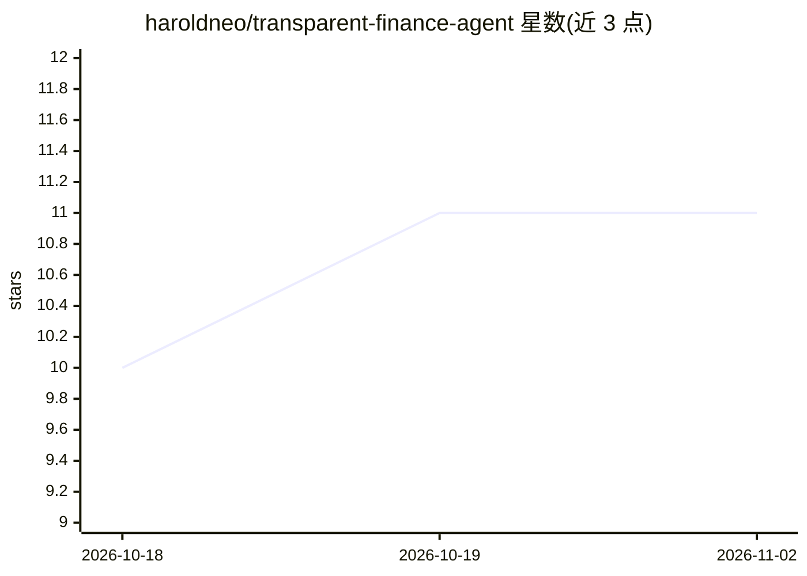

# haroldneo/transparent-finance-agent

⭐ 11 · TypeScript · MIT · 推送 2026-07-25 · [GitHub](https://github.com/haroldneo/transparent-finance-agent) · [官网](https://transparent-finance-agent.harold1998z.chatgpt.site) · 个人维护 · 中文 README

**面向一人公司的财务报税 Agent：票据记账、分析与报税闭环**

为一人公司（OPC）开发的开源财务报税应用：支持 PDF/照片票据导入并生成会计凭证建议，提供可追溯自动记账与三大财务报表、自然语言经营问答，以及 Windows 税务系统的自动填表、校验和人工提交关口；最终提交前保留人工确认。技术栈为 Next.js/React/TypeScript，本地运行需 Node.js >=22.13.0。公开版本中的经营与税务数据均为合成内容，票据导入仅在浏览器会话内本地预览、不上传文件。

## 筛选速览

| 维度 | 判定 | 备注 |
|---|---|---|
| AI 角色 | `ai-native` | 本体是模型或模型工具 |
| 许可风险 | `permissive` | MIT |
| 部署形态 | `library` | 以包/库形式分发 |
| 模型依赖 | — | README 未给出锁定关系 |
| 硬件要求 | — | 无带数字的原话,不猜 |
| 安装摩擦 | `low` | 无编译、无系统依赖或容器化 |
| 成熟度 | — | 结构信号不足 |

## 能力要点

- PDF/照片票据导入与会计凭证建议
- 可追溯自动记账与三大财务报表
- Windows 税务系统自动填表与人工提交关口
- 最终提交前保留人工确认环节

## 适用场景

- 一人公司自动记账并生成财务报表
- 用自然语言询问经营状况
- 在中国税务系统完成填表与校验后人工提交

## 场景标签

`文档解析` `文档问答` `GUI 自动化` · 领域:效率与自动化

## 证据(README 行号)

> L3: 为一人公司（OPC）而生的开源财务报税 Agent。它把票据识别、自动记账、
> L14: - 自然语言经营问答

## 星数曲线

2026-10-18 10 → 2026-11-02 11（+1）

---
*卡片 v1 · prompt 1.4 · 生成 2026-11-02 · 置信度 high · 依据 README sha `1152698e8c05` · [字段定义](../../DATASET.md)*
