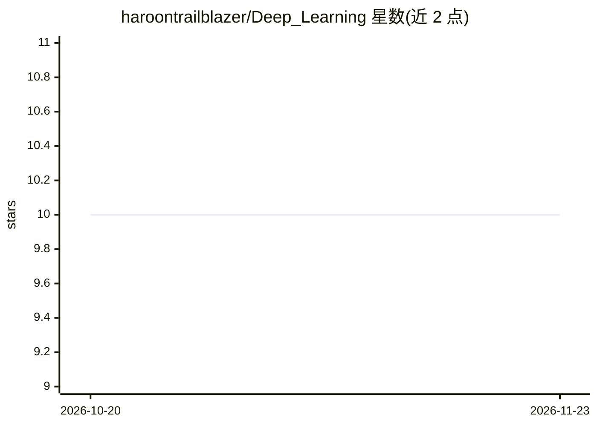

# haroontrailblazer/Deep_Learning

⭐ 10 · Jupyter Notebook · 推送 2025-12-14 · [GitHub](https://github.com/haroontrailblazer/Deep_Learning) · 个人维护

**面向学习者的深度学习算法实现合集**

一个手工实现深度学习程序的合集，涵盖 PCA、KNN、DNN、CNN、LSTM 等从基础算法到常见架构的内容。每个实现以清晰性、可视化与可复用为组织目标，仓库定位为帮助学习者掌握核心概念与架构的实践材料，面向初学者、动手实验者与面试准备者。README 未给出安装步骤、依赖清单或运行说明，可见内容仅为目录介绍。

## 筛选速览

| 维度 | 判定 | 备注 |
|---|---|---|
| AI 角色 | `ai-knowledge` | 知识聚合/清单类 |
| 许可风险 | `none` | — |
| 部署形态 | `None` |  |
| 模型依赖 | — | README 未给出锁定关系 |
| 硬件要求 | — | 无带数字的原话,不猜 |
| 安装摩擦 | `low` | 无编译、无系统依赖或容器化 |
| 成熟度 | — | 结构信号不足 |

## 能力要点

- 包含 PCA、KNN、DNN、CNN、LSTM 等算法实现
- README 声明实现注重清晰性、可视化与可复用性
- 定位为学习与面试准备用的实践合集

## 适用场景

- 学习深度学习基础算法的实现细节
- 面试前复习经典模型与算法
- 参考可视化代码理解模型结构

## 场景标签

`教程课程` · 领域:学习与行业

## 证据(README 行号)

> L3: Welcome to **Deep Learning Lab**, a collection of hands-on deep learning programs designed to help you master core c
> L13: Each implementation is built for clarity, visualization, and reusability — perfect for learners, interview prep, an

## 星数曲线

2026-10-20 10 → 2026-11-23 10（+0）

---
*卡片 v1 · prompt 1.4 · 生成 2026-11-19 · 置信度 mid · 依据 README sha `f89340f8bcf3` · [字段定义](../../DATASET.md)*
