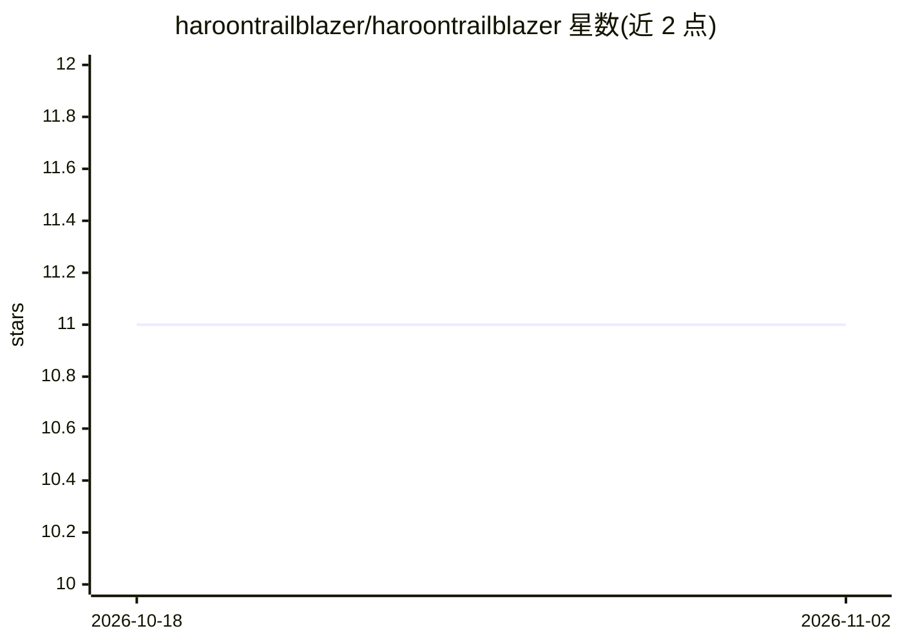

# haroontrailblazer/haroontrailblazer

⭐ 11 · HTML · 推送 2026-07-19 · [GitHub](https://github.com/haroontrailblazer/haroontrailblazer) · 个人维护

**个人 GitHub 主页 README：AI/ML 工程师技能与项目展示**

这是 haroontrailblazer 的 GitHub 个人主页配置仓库，非可安装的软件产品。内容为个人介绍：Anna University AI 与数据科学专业在读，方向为 LLM、Agentic AI 与 RAG 管道；列出技术栈（LangChain、FAISS、PyTorch、各类云平台与数据库）、AI 工具（Claude、ChatGPT、Ollama 等）、6 个精选项目（含 EduOrchestrate、vector-less RAG）以及 Cisco/IBM/Google/Oracle/Anthropic 等机构认证。不提供安装、运行方式。

## 筛选速览

| 维度 | 判定 | 备注 |
|---|---|---|
| AI 角色 | `ai-knowledge` | 知识聚合/清单类 |
| 许可风险 | `none` | — |
| 部署形态 | `None` |  |
| 模型依赖 | — | README 未给出锁定关系 |
| 硬件要求 | — | 无带数字的原话,不猜 |
| 安装摩擦 | `low` | 无编译、无系统依赖或容器化 |
| 成熟度 | — | 结构信号不足 |

## 能力要点

- 声明技术方向为多智能体编排、向量/无向量 RAG 与 ML 模型部署
- 列出 6 个精选项目（LangGraph 多智能体系统、推理式检索等）
- 含 18 项认证记录（Cisco、IBM、Google Cloud、Oracle、Anthropic 等）

## 适用场景

- 了解该开发者的技能背景与项目列表
- 作为 GitHub 主页展示模板参考

## 场景标签

 · 领域:个人主页/开发者档案

## 证据(README 行号)

> L11: AI / ML Engineer — LLMs · Agentic AI · RAG Pipelines
> L38: ```python
> L132: |**EduOrchestrate**|Multi-agent AI system for academic & administrative operations — `LangGraph`|

## 星数曲线



2026-10-18 11 → 2026-11-02 11（+0）


---
*卡片 v1 · prompt 1.4 · 生成 2026-11-02 · 置信度 mid · 依据 README sha `5ea1870eb382` · [字段定义](../../DATASET.md)*
