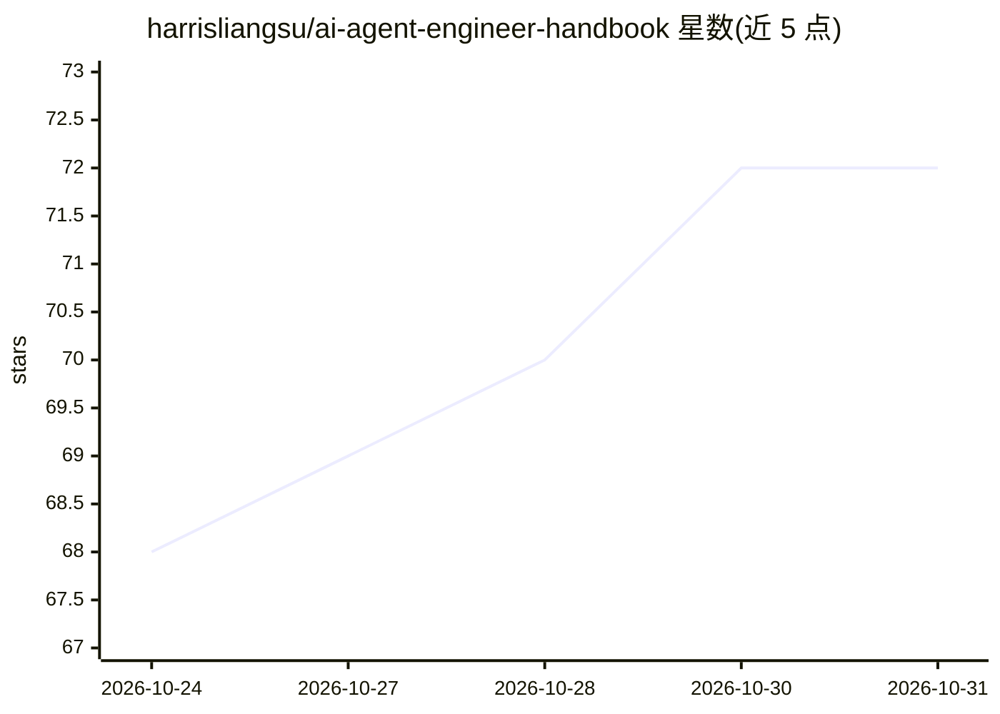

# harrisliangsu/ai-agent-engineer-handbook

⭐ 72 · HTML · MIT · 推送 2026-10-29 · [GitHub](https://github.com/harrisliangsu/ai-agent-engineer-handbook) · [官网](https://harrisliangsu.github.io/ai-agent-engineer-handbook/) · 个人维护 · 中文 README

**中文 AI Agent 工程师面试与学习手册：四层工程体系+JD 拆解+92 道面试题**

面向 AI Agent / LLM 应用方向求职、转型、带队或招聘的工程师的中文一手手册。知识部分按 Prompt→Context→Agent→Harness 四层组织，每层一篇长文并附 50+ 条参考；实战部分收录中国与北美 22 条真实 JD 摘录与薪资数据，以及 92 道 11 类面试题（含难度分级与一手来源 URL）。另含四篇 Anthropic/OpenAI 文章的非官方中译与知识图谱。可在线阅读、看 Markdown 或本地起 HTTP 服务阅读；内容由作者用 Claude Code 与本地 deep-research 工作流整理，并声明数字可能随时间过时。

## 筛选速览

| 维度 | 判定 | 备注 |
|---|---|---|
| AI 角色 | `ai-knowledge` | 知识聚合/清单类 |
| 许可风险 | `permissive` | MIT |
| 部署形态 | `None` |  |
| 模型依赖 | — | README 未给出锁定关系 |
| 硬件要求 | — | 无带数字的原话,不猜 |
| 安装摩擦 | `low` | 无编译、无系统依赖或容器化 |
| 成熟度 | — | 结构信号不足 |

## 能力要点

- 四层工程知识体系（Prompt/Context/Agent/Harness），bibilography 50+ 条核心参考
- 22 条中国与北美真实 JD verbatim 摘录 + 薪资分级 + 45+ 来源
- 92 道题、11 大分类，每题含难度分级与一手论文/文档 URL
- 四篇 Anthropic/OpenAI 经典文章非官方中译 + 全景知识图谱

## 适用场景

- 准备 AI Agent / LLM 应用方向的工程面试
- 按应届/中级/资深/架构师路径系统学习 Agent 工程
- 招聘方校准岗位要求、面试官按层出题

## 场景标签

`教程课程` `精选清单` · 领域:学习与行业

## 证据(README 行号)

> L3: 中文 AI Agent / LLM 应用工程师的一站式手册：先建立 **Prompt → Context → Agent → Harness** 四层工程坐标，再落到真实 JD 与面试题库。

## 星数曲线

2026-10-24 68 → 2026-10-31 72（+4）

---
*卡片 v1 · prompt 1.4 · 生成 2026-10-24 · 置信度 high · 依据 README sha `69d6798c5563` · [字段定义](../../DATASET.md)*
