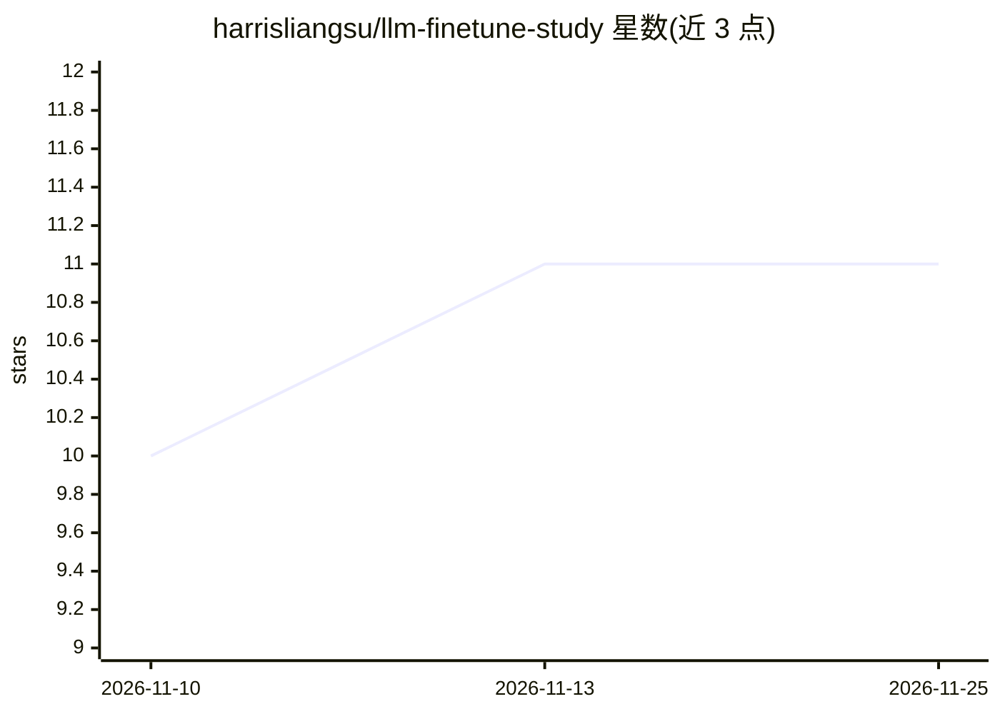

# harrisliangsu/llm-finetune-study

⭐ 11 · HTML · MIT · 推送 2026-10-23 · [GitHub](https://github.com/harrisliangsu/llm-finetune-study) · [官网](https://harrisliangsu.github.io/llm-finetune-study/) · 个人维护 · 中文 README

**本地 LLM 微调实战课程，附浏览器训练工作室**

一个以中文为主的 10 节可执行课程仓库，覆盖 datasets 管线、tokenizer、Trainer、SFT、LoRA/PEFT、DPO、QLoRA 规划与 RLHF 概念，面向只有本地电脑或普通开发机的学习者，从小模型、小数据集入手走通训练流程。附带一个必须本机启动的网页训练工作室，用于配置训练 run、校验 JSONL、查看 loss/张量/adapter/trace；课程 HTML 可经 GitHub Pages 在线阅读，但训练功能不在线上提供。明确不建议本地 full fine-tune 7B/13B。

## 筛选速览

| 维度 | 判定 | 备注 |
|---|---|---|
| AI 角色 | `ai-knowledge` | 知识聚合/清单类 |
| 许可风险 | `permissive` | MIT |
| 部署形态 | `None` |  |
| 模型依赖 | — | README 未给出锁定关系 |
| 硬件要求 | — | 无带数字的原话,不猜 |
| 安装摩擦 | `medium` | 含编译或系统依赖之一 |
| 成熟度 | — | 结构信号不足 |

## 能力要点

- 10 节课程覆盖 SFT、LoRA/PEFT、DPO 到 QLoRA 工程边界
- 本地网页 Studio 可配置训练 run 并可视化 loss、张量、adapter 与 trace
- 课程示例从 Hugging Face 下载真实模型（如 Qwen2.5-0.5B-Instruct）运行
- QLoRA 课以硬件与工程规划为主，说明 CUDA/bitsandbytes 与 Mac/MPS 的边界

## 适用场景

- 在本地电脑上系统学习 LLM 微调的完整流程
- 对照开源中文 LLM 微调项目理解训练脚本与数据格式
- 通过网页工作室观察训练过程中的 loss 与张量变化
- 为后续学习 Agent、RAG 打好微调基础

## 场景标签

`教程课程` `微调` · 领域:学习与行业

## 证据(README 行号)

> L9: > 在本地电脑上把 LLM 微调走通：10 节可执行课程，从数据、tokenizer、Trainer 到 SFT、LoRA / PEFT、DPO 和 QLoRA 规划。
> L54: - 想系统学习 LLM 微调，但只有本地电脑或普通开发机
> L120: |模型训练|默认首页。选择训练方法、模型、JSONL 数据、基础参数/高级参数，启动一次独立 Studio run。|`visualizer/runtime/studio-runs/<run-id>/`|

## 星数曲线

2026-11-10 10 → 2026-11-25 11（+1）

---
*卡片 v1 · prompt 1.4 · 生成 2026-11-18 · 置信度 high · 依据 README sha `8e5e9a86a70a` · [字段定义](../../DATASET.md)*
