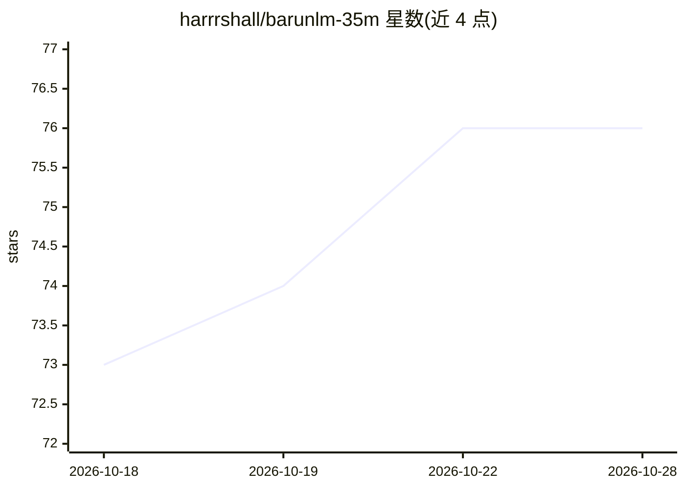

# harrrshall/barunlm-35m

⭐ 76 · Python · Apache-2.0 · 推送 2026-08-05 · [GitHub](https://github.com/harrrshall/barunlm-35m) · [官网](https://huggingface.co/harrrshall/BarunLM-35M) · 个人维护

**35M 参数小型基座语言模型，5.7B token 预训练**

BarunLM-35M 是一个 35,072,768 参数的基座语言模型，在 5.7B token 上预训练。架构采用 3:1 局部-全局注意力调度、每四层一组的可学习残差选择器、分组查询注意力、50% 部分 RoPE、门控注意力输出与有界 SwiGLU，词表 16,384，上下文 2,048 token。README 给出九项零样本基准结果（宏准确率 41.01%，经去污染处理），并提供从 Hugging Face 下载权重、SHA-256 校验的快速开始示例。定位为研究与教育用途的基座模型，无指令微调。

## 筛选速览

| 维度 | 判定 | 备注 |
|---|---|---|
| AI 角色 | `ai-native` | 本体是模型或模型工具 |
| 许可风险 | `permissive` | Apache-2.0 |
| 部署形态 | `None` |  |
| 模型依赖 | — | README 未给出锁定关系 |
| 硬件要求 | — | 无带数字的原话,不猜 |
| 安装摩擦 | `medium` | 含编译或系统依赖之一 |
| 成熟度 | — | 结构信号不足 |

## 能力要点

- 3:1 局部-全局注意力调度与可学习残差选择器
- 5.70B token 预训练，训练数据涵盖教育文本、数学、网页与代码
- 九任务零样本基准 41.01%，排除 1,854 条污染样本
- 提供 Hugging Face 权重下载与 SHA-256 校验，CUDA 可用时自动使用

## 适用场景

- 研究紧凑语言模型的参数效率设计
- 本地小规模文本生成实验与原型开发
- 教育用途学习语言模型训练配方

## 场景标签

 · 领域:自然语言处理/语言模型

## 证据(README 行号)

> L7: BarunLM-35M achieves **41.01%** on a fixed, decontaminated nine-task zero-shot benchmark at **35,072,768 parameters*
> L135: * Text-generation experiments

## 星数曲线

2026-10-18 73 → 2026-10-28 76（+3）

---
*卡片 v1 · prompt 1.4 · 生成 2026-10-24 · 置信度 high · 依据 README sha `968bf70c354c` · [字段定义](../../DATASET.md)*
