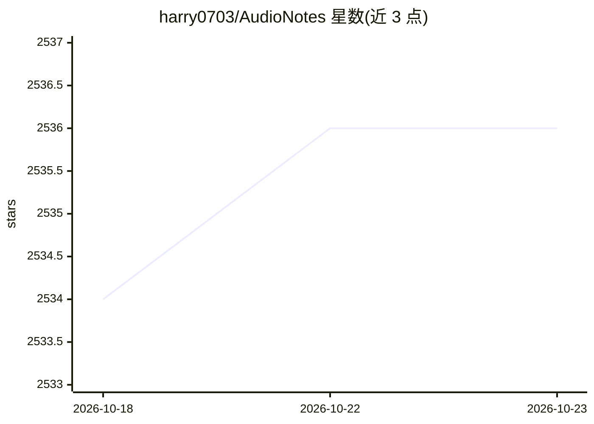

# harry0703/AudioNotes

⭐ 2,536 · Python · MIT · 推送 2026-08-19 · [GitHub](https://github.com/harry0703/AudioNotes) · 个人维护 · 中文 README

**本地音视频转文字并整理成 Markdown 笔记的工具**

面向整理会议、访谈、课程和语音备忘录的用户：上传或录制音视频后，由本地 FunASR 模型生成文字稿，再由本地 Ollama 运行的 qwen3.5:2b 整理成结构化 Markdown 笔记，并支持基于内容的持续问答与对话历史。处理全程在本机完成，默认不发送第三方 AI 接口，Web 页面仅限本机访问。提供 Docker 镜像（含可选 NVIDIA GPU 加速配置）与源码两种启动方式；源码方式需 Python 3.12、ffmpeg 和 Ollama。默认模型针对中文优化，识别效果受录音质量影响。

## 筛选速览

| 维度 | 判定 | 备注 |
|---|---|---|
| AI 角色 | `ai-native` | 本体是模型或模型工具 |
| 许可风险 | `permissive` | MIT |
| 部署形态 | `self-host` | docker 或自建部署 |
| 模型依赖 | local-ok | 支持本地模型 |
| 硬件要求 | — | 无带数字的原话,不猜 |
| 安装摩擦 | `low` | 无编译、无系统依赖或容器化 |
| 成熟度 | — | 结构信号不足 |

## 能力要点

- FunASR 本地语音识别 + Ollama 本地 LLM 笔记整理
- 音视频、文字稿、笔记与对话历史全部保存在本机
- 支持浏览器录音、领域热词、内容追问与历史记录
- Docker 一键部署，可选 NVIDIA GPU 加速配置

## 适用场景

- 把会议或访谈录音整理成结构化笔记
- 上传课程视频生成文字稿并就内容提问
- 在不上传云端的前提下处理敏感语音备忘录

## 场景标签

`语音识别` `文档问答` `AI 写作` · 领域:内容生成

## 证据(README 行号)

> L7: - 上传音频或视频，自动生成文字稿。
> L17: - FunASR 在本地识别语音，Ollama 在本地运行大语言模型。

## 星数曲线

2026-10-18 2,534 → 2026-10-23 2,536（+2）

---
*卡片 v1 · prompt 1.4 · 生成 2026-10-21 · 置信度 high · 依据 README sha `db804708725b` · [字段定义](../../DATASET.md)*
