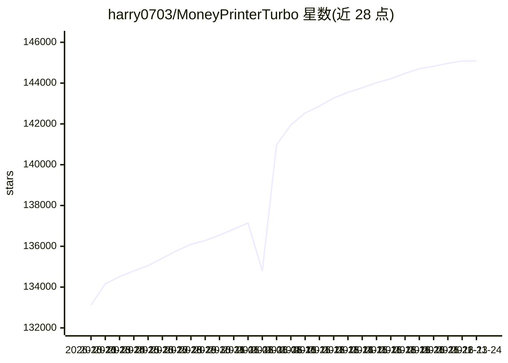

# harry0703/MoneyPrinterTurbo

⭐ 145,244 · Python · MIT · 推送 2026-11-23 · [GitHub](https://github.com/harry0703/MoneyPrinterTurbo) · 个人维护 · 中文 README

**给内容创作者：从主题一键生成脚本配音字幕的高清短视频**

一站式 AI 短视频生成工具：输入主题或关键词后自动完成脚本撰写、素材匹配、配音、字幕、背景音乐与成片合成，支持 9:16/16:9/1:1 三种画幅及批量生成。提供 WebUI、API、CLI 和 AI Agent 四种使用方式，模型服务、TTS 与素材源均通过填写对应 API Key 配置。脚本可由云端大模型生成或用户自定义，素材支持本地上传与 Pexels 等库存源，生成后可自动发布到 TikTok、Instagram、YouTube Shorts。GPU 非必需。

## 筛选速览

| 维度 | 判定 | 备注 |
|---|---|---|
| AI 角色 | `ai-native` | 本体是模型或模型工具 |
| 许可风险 | `permissive` | MIT |
| 部署形态 | `desktop` | 安装包/桌面程序 |
| 模型依赖 | local-ok | 支持本地模型 |
| 硬件要求 | `gpu-8g` | |
| 安装摩擦 | `low` | 无编译、无系统依赖或容器化 |
| 成熟度 | — | 结构信号不足 |

## 动量与使用信号

- 维护:`active` — 距上次 push 1.3 天,年发版 12,132 位贡献者
- 涨星:近 1 天 **+487**(自 20261016 起算)
- 安装:pypi 包 `mpt` 月下载 2
- 平台:WINDOWS / WEB · 协议:OLLAMA

## 能力要点

- 主题到成片全流程自动化：脚本、配音、素材、字幕、配乐、剪辑
- 四种使用方式：WebUI、API、CLI、AI Agent
- 集成 Edge TTS（免费无需 Key）等十余种配音服务，支持声音克隆
- 生成完成可一键自动发布至 TikTok、Instagram、YouTube Shorts

## 适用场景

- 输入一个主题快速批量产出短视频
- 自媒体账号的自动化内容生产与跨平台发布
- 不写代码通过 WebUI 配置 API Key 生成视频

## 场景标签

`视频生成` `语音合成` `AI 写作` · 领域:内容生成

## 证据(README 行号)

> L5: 只需提供视频 主题 或 关键词 ，即可自动生成视频脚本、匹配素材、生成字幕和背景音乐，并合成高清短视频。
> L157: - [x] 提供 **AI Agent、WebUI、API 和 CLI** 四种使用方式，既能快速上手，也能接入自动化流程
> L165: - [x] 支持 Kimi / Moonshot AI、OpenAI、Anthropic Claude、Google Gemini、DeepSeek、阿里云通义千问、Microsoft Azure OpenAI、火山引擎方舟、x

## 星数曲线

2026-10-21 133,121 → 2026-11-24 145,084（+11,963）

---
*卡片 v1 · prompt 1.4 · 生成 2026-11-22 · 置信度 high · 依据 README sha `bd4edb94b48e` · [字段定义](../../DATASET.md)*
