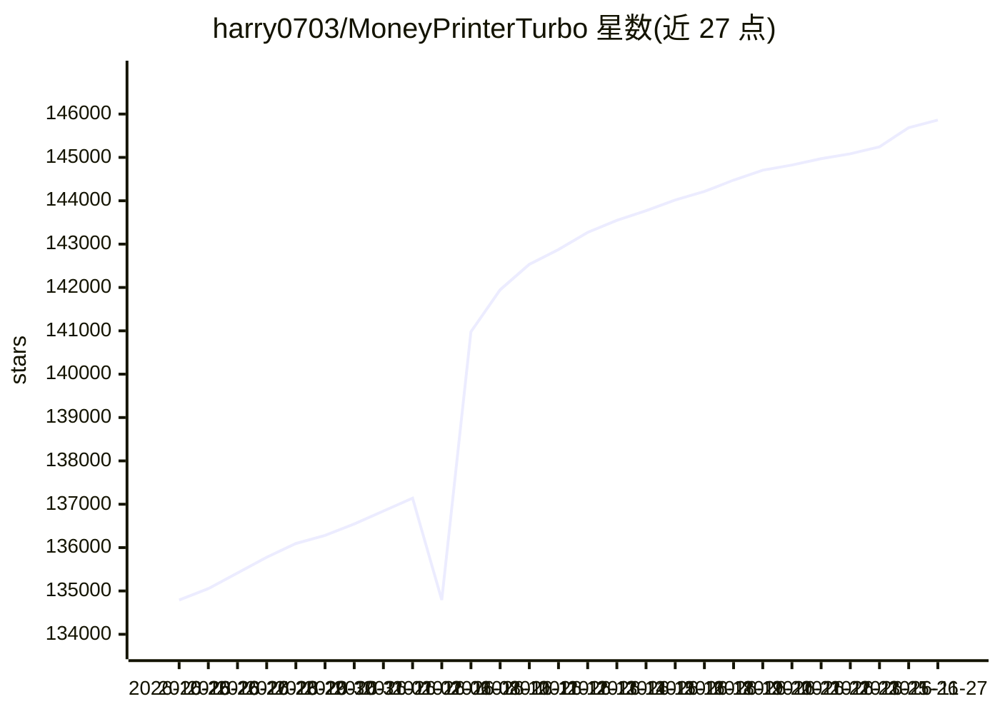

# harry0703/MoneyPrinterTurbo

⭐ 145,863 · Python · MIT · 推送 2026-11-26 · [GitHub](https://github.com/harry0703/MoneyPrinterTurbo) · 个人维护 · 中文 README

**输入主题一键生成配音、字幕、素材齐全的高清短视频**

一站式 AI 短视频生成工具：提供 AI Agent、WebUI、API 和 CLI 四种使用方式，从主题或关键词自动完成脚本生成、配音、素材匹配、字幕、配乐与剪辑合成，输出 9:16/16:9/1:1 三种画幅的成片，并支持一键发布至 TikTok、Instagram 和 YouTube Shorts。脚本生成支持多家模型服务与聚合网关，配音集成 Edge TTS、Azure Speech 等服务，字幕可用 TTS 时间戳或本地 Whisper 生成。本地部署需 Python 3.11+，GPU 非必需但可加速本地转录与批量处理。

## 筛选速览

| 维度 | 判定 | 备注 |
|---|---|---|
| AI 角色 | `ai-native` | 本体是模型或模型工具 |
| 许可风险 | `permissive` | MIT |
| 部署形态 | `desktop` | 安装包/桌面程序 |
| 模型依赖 | local-ok | 支持本地模型 |
| 硬件要求 | `gpu-8g` | |
| 安装摩擦 | `low` | 无编译、无系统依赖或容器化 |
| 成熟度 | — | 结构信号不足 |

## 动量与使用信号

- 维护:`active` — 距上次 push 1.3 天,年发版 12,132 位贡献者
- 涨星:近 1 天 **+487**(自 20261016 起算)
- 安装:pypi 包 `mpt` 月下载 2
- 平台:WINDOWS / WEB · 协议:OLLAMA

## 能力要点

- AI Agent、WebUI、API、CLI 四种使用方式，支持批量生成与任务历史
- 集成 Edge TTS、Azure Speech 等多种配音服务，支持声音克隆
- 支持从 Pexels/Pixabay/Coverr 获取素材、上传本地素材及多家文生视频服务
- 生成完成后自动发布至 TikTok、Instagram 和 YouTube Shorts

## 适用场景

- 输入一个主题快速批量产出短视频内容
- 为 TikTok/Instagram/YouTube Shorts 自动生成并发布视频
- 接入自动化流程（API/n8n）批量生产短视频

## 场景标签

`视频生成` · 领域:内容生成

## 证据(README 行号)

> L5: 只需提供视频 主题 或 关键词 ，即可自动生成视频脚本、匹配素材、生成字幕和背景音乐，并合成高清短视频。
> L157: - [x] 提供 **AI Agent、WebUI、API 和 CLI** 四种使用方式，既能快速上手，也能接入自动化流程
> L164: - [x] 支持 AI 自动生成或改写 **多语言视频脚本**，也可以直接使用自定义脚本

## 星数曲线

2026-10-25 134,792 → 2026-11-27 145,863（+11,071）

---
*卡片 v1 · prompt 1.4 · 生成 2026-11-26 · 置信度 high · 依据 README sha `08987c10c25c` · [字段定义](../../DATASET.md)*
