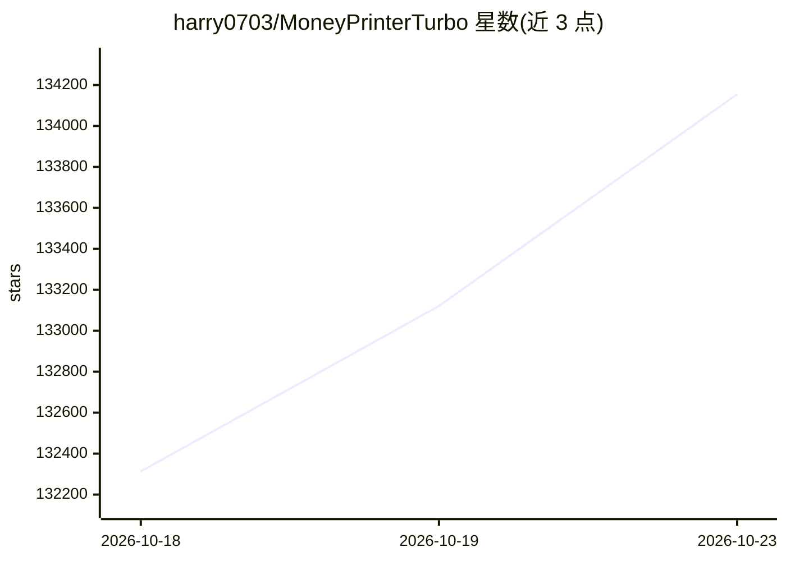

# harry0703/MoneyPrinterTurbo

⭐ 134,155 · Python · MIT · 推送 2026-10-22 · [GitHub](https://github.com/harry0703/MoneyPrinterTurbo) · 个人维护 · 中文 README

**给内容创作者：按主题一键生成配音字幕齐全的高清短视频**

以主题或关键词为输入的自动化短视频生成流水线：依次完成脚本生成、素材匹配（本地/库存/AI 文生视频）、配音（Edge TTS 等多种服务）、字幕生成（edge/whisper 两种模式）、背景音乐合成与成片剪辑，支持 9:16/16:9/1:1 三种画幅及批量生成。提供 AI Agent、WebUI、API 和 CLI 四种使用方式，可一键上传至 TikTok、Instagram、YouTube Shorts。脚本生成依赖外部大模型 API Key，GPU 非必需。

## 筛选速览

| 维度 | 判定 | 备注 |
|---|---|---|
| AI 角色 | `ai-enhanced` | 去掉 AI 部分产品仍成立 |
| 许可风险 | `permissive` | MIT |
| 部署形态 | `desktop` | 安装包/桌面程序 |
| 模型依赖 | local-ok | 支持本地模型 |
| 硬件要求 | `gpu-8g` | |
| 安装摩擦 | `low` | 无编译、无系统依赖或容器化 |
| 成熟度 | — | 结构信号不足 |

## 动量与使用信号

- 维护:`active` — 距上次 push 1.3 天,年发版 12,132 位贡献者
- 涨星:近 1 天 **+487**(自 20261016 起算)
- 安装:pypi 包 `mpt` 月下载 2
- 平台:WINDOWS / WEB · 协议:OLLAMA

## 能力要点

- 提供 AI Agent、WebUI、API 和 CLI 四种使用方式
- 支持 Kimi、OpenAI、Claude、Gemini、DeepSeek、通义千问等多种模型服务及统一网关
- 集成 Edge TTS（免费无 Key）等十余种配音服务与 faster-whisper 本地转写
- 支持跨平台自动发布至 TikTok、Instagram、YouTube Shorts

## 适用场景

- 输入一个主题批量产出带货或科普短视频
- 用 CLI 批处理清单顺序生成多条视频任务
- 通过 API 把视频生成接入自己的自动化工作流

## 场景标签

`视频生成` `语音合成` · 领域:内容生成

## 证据(README 行号)

> L5: 只需提供视频 主题 或 关键词 ，即可自动生成视频脚本、匹配素材、生成字幕和背景音乐，并合成高清短视频。
> L118: - [x] 提供 **AI Agent、WebUI、API 和 CLI** 四种使用方式，既能快速上手，也能接入自动化流程
> L125: - [x] 支持 Kimi / Moonshot AI、OpenAI、Anthropic Claude、Google Gemini、DeepSeek、阿里云通义千问、Microsoft Azure OpenAI、火山引擎方舟、x

## 星数曲线

2026-10-18 132,313 → 2026-10-23 134,155（+1,842）

---
*卡片 v1 · prompt 1.4 · 生成 2026-10-18 · 置信度 high · 依据 README sha `3be95074f7e4` · [字段定义](../../DATASET.md)*
